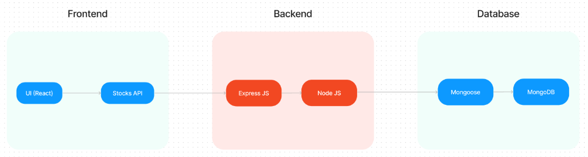
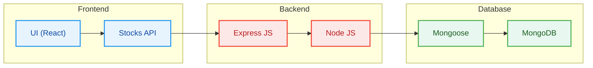
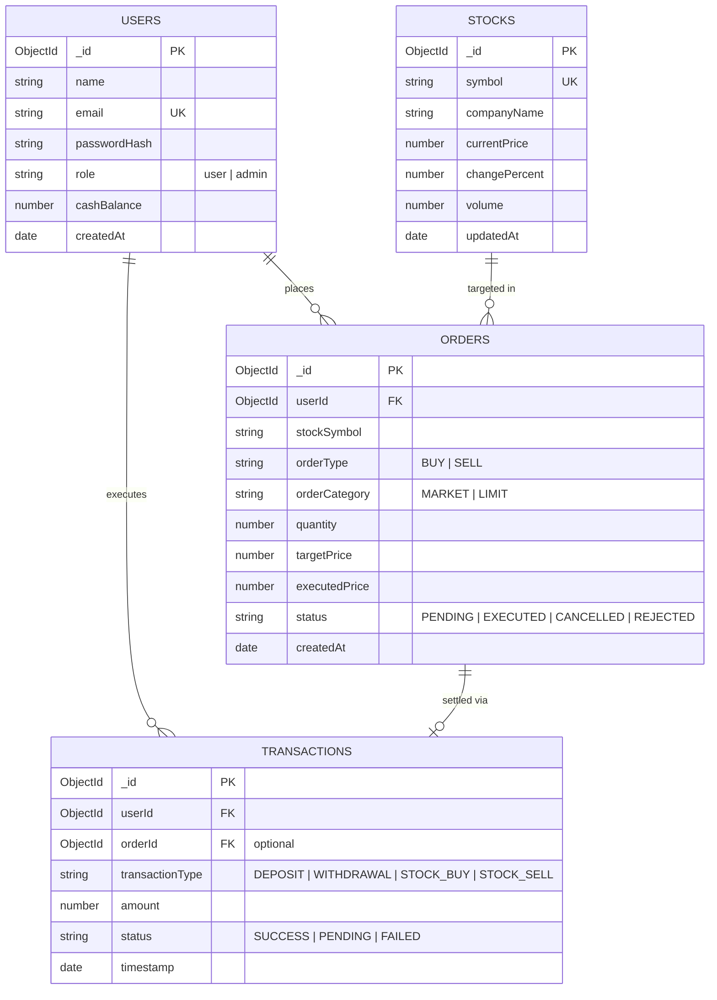
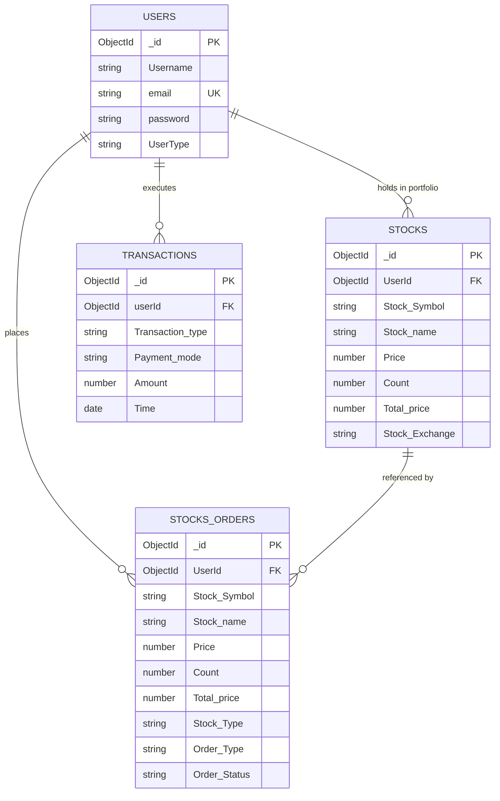
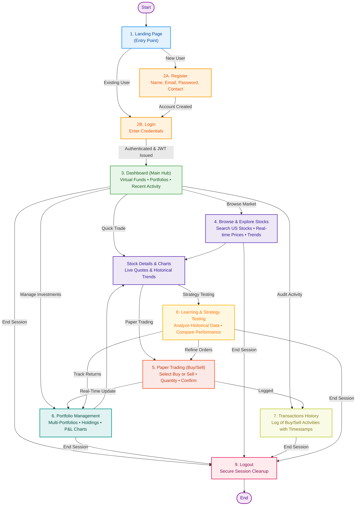
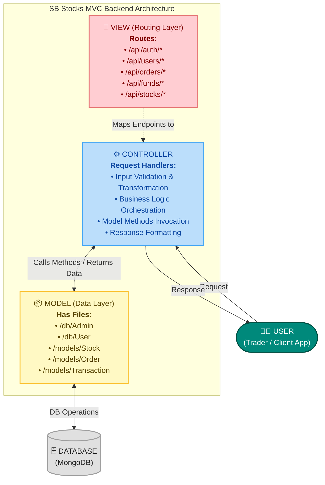

# TradeX — Smart Stock Trading and Portfolio Management

[](https://react.dev/)
[](https://expressjs.com/)
[](https://nodejs.org/)
[](https://mongoosejs.com/)
[](https://www.mongodb.com/)
[](#-sb-stocks-user-flow)
[](#-model-view-controller-mvc-pattern)

TradeX is an end-to-end stock trading and portfolio management web platform. Designed with a modular 3-tier architecture, it empowers users to explore financial markets with real-time stock charts, execute buy/sell orders, manage cash wallets, and track portfolio performance, while providing administrators with complete oversight and system controls.

---

## 🌟 Core Features

TradeX delivers a high-performance simulation ecosystem designed for traders to learn, test, and master the stock market without financial risk.

| Feature | Description |
| :--- | :--- |
| **🔐 User Registration & Authentication** | Secure sign-up and login process with personalized dashboards. |
| **⚡ Real-Time Market Data** | Live US stock prices, updates, and market trends for accurate trading simulations. |
| **📈 Historical Data & Trends** | Access stock performance history to analyze and test strategies effectively. |
| **💼 Virtual Portfolios** | Create and manage multiple portfolios with diverse stocks. Track overall performance, profits, and losses. |
| **📝 Transaction Management** | Log of all buy/sell activities linked to specific users and stocks. |
| **🌐 Comprehensive Stock Listings** | Browse through a wide range of stocks listed in the US market. |
| **🎯 Strategy Testing & Analysis** | Analyze past performance and refine trading strategies. |
| **🎨 User-Friendly Interface** | Intuitive design for both beginners and advanced traders. |

### 🔍 Feature Breakdown

- **🔐 User Registration & Authentication**
  - Secure sign-up and login process with personalized dashboards.
  - JWT token-based authentication and role-based permissions (User vs. Admin).

- **⚡ Real-Time Market Data**
  - Live US stock prices, updates, and market trends for accurate trading simulations.
  - Real-time price tracking and market movers across major US exchanges.

- **📈 Historical Data & Trends**
  - Access stock performance history to analyze and test strategies effectively.
  - Multi-period interactive charts (1D, 1W, 1M, 1Y) with OHLCV data.

- **💼 Virtual Portfolios**
  - Create and manage multiple portfolios with diverse stocks.
  - Track overall performance, profits, and losses (realized & unrealized P&L).

- **📝 Transaction Management**
  - Log of all buy/sell activities linked to specific users and stocks.
  - Comprehensive audit trail with detailed transaction receipts and execution timestamps.

- **🌐 Comprehensive Stock Listings**
  - Browse through a wide range of stocks listed in the US market.
  - Search by ticker or company name, filter by sectors, and evaluate key market metrics.

- **🎯 Strategy Testing & Analysis**
  - Analyze past performance and refine trading strategies.
  - Test order execution scenarios (Market and Limit orders) in a risk-free environment.

- **🎨 User-Friendly Interface**
  - Intuitive design for both beginners and advanced traders.
  - Responsive, modern UI featuring visual market charts, dark theme aesthetics, and fast trade slips.

> 📖 *For exhaustive documentation, technical flows, and architecture mappings, explore the [Platform Features Specification](docs/FEATURES.md).*

---

## 🏛️ System Architecture

TradeX is structured into three distinct layers: **Frontend**, **Backend**, and **Database**.

### 📐 Visual Architecture Diagram





### Architectural Breakdown

- **Frontend**: The frontend is represented by the "Frontend" section, including user interface components such as **Landing page**, **User home**, **Admin dashboard**, **Stock charts**, **Stock orders**, and **User stock portfolio**. It incorporates the **Stocks API** client to communicate with backend services and market data streams.
- **Backend**: The backend is represented by the "Backend" section, consisting of API endpoints for **Users**, **Deposits and Withdrawal of funds**, **Transactions**, and **Stock orders**. It also includes **Admin Authentication** and an **Admin Dashboard** for operational monitoring and platform oversight, built on **Express.js** and **Node.js**.
- **Database**: The Database section represents the database that stores collections for **Users**, **Stocks**, **Orders**, and **Transactions**, modeled with **Mongoose** schemas and persisted in **MongoDB**.

> 📖 *For complete architecture specifications, technical flows, and component diagrams, explore the dedicated [System Architecture Specification](docs/ARCHITECTURE.md).*

### Architecture Data Flow
1. **User Interaction**: Users interact with the React user interface to view market data, place orders, or request fund deposits/withdrawals.
2. **Stocks API Client**: The React frontend communicates with internal backend endpoints and third-party stock data feeds via the Stocks API integration layer.
3. **Express.js HTTP Router**: Incoming requests pass through Express.js middleware for authentication, authorization, and validation.
4. **Node.js Core Services**: Business logic handles order matching, portfolio calculations, fund balance mutations, and transaction auditing.
5. **Mongoose ODM**: Strongly typed schemas validate documents before executing database queries.
6. **MongoDB Storage**: High-performance NoSQL database housing collections for users, stocks, orders, and financial transactions.

---

## 👥 Rules and Responsibilities

The TradeX (SB Stocks Platform) ecosystem is organized around three primary entities, each with distinct operational scopes and responsibilities:

| Entity | Core Responsibility Summary |
| :--- | :--- |
| **🧑‍💻 1. User (Trader)** | Account onboarding, portfolio creation, transaction tracking, and strategy testing. |
| **⚡ 2. System (SB Stocks Platform)** | Market data streaming, secure data handling, transaction recording, and smooth UI delivery. |
| **👨‍💼 3. Admin** | System health, fairness monitoring, market catalog management, and compliance enforcement. |

### 1. 🧑‍💻 User (Trader)
- **Register and create an account.**
- **Login securely and access trading dashboard.**
- **Create and manage multiple virtual portfolios.**
- **Track transactions, monitor stock performance, and analyze portfolio growth.**
- **Use real-time and historical stock data to practice strategies.**

### 2. ⚡ System (SB Stocks Platform)
- **Provide real-time stock prices and historical market data.**
- **Ensure secure registration, login, and user data handling.**
- **Record and manage all transactions linked to users and stocks.**
- **Maintain consistency and accuracy in portfolio updates.**
- **Deliver a smooth, fast, and user-friendly interface.**

### 3. 👨‍💼 Admin
- **Manage overall application performance and security.**
- **Monitor user activity and transactions for fairness.**
- **Update and maintain stock listings and market data sources.**
- **Handle technical issues, bugs, and data accuracy.**
- **Ensure compliance with trading simulation standards.**

> 📖 *For complete architectural blueprints, responsibility matrices, and lifecycle diagrams, see the [System Architecture Specification](docs/ARCHITECTURE.md#rules-and-responsibilities).*

---

## 💻 Tier 1: Frontend (React)

The frontend is built using **React**, delivering an intuitive, responsive, and data-rich user interface.

### Key UI Components

| Component | Description |
| :--- | :--- |
| **Landing Page** | The platform gateway featuring market highlights, value proposition, feature summaries, and authentication entry points (Sign Up / Sign In). |
| **User Home** | The trader's command center displaying watchlist summaries, recent market movers, wallet balance, and quick actions to trade or add funds. |
| **Admin Dashboard** | Dedicated administrative view to monitor system health, manage registered users, review pending transactions, and inspect platform trading volumes. |
| **Stock Charts** | Interactive visual charts (candlestick and line views) for real-time and historical stock price trajectories, supporting configurable timeframes (1D, 1W, 1M, 1Y). |
| **Stock Orders** | Interactive trading interface enabling users to create **Buy** and **Sell** orders (Market & Limit orders) with real-time price estimation and instant order confirmation. |
| **User Stock Portfolio** | Comprehensive portfolio tracker displaying current holdings, average purchase price, market valuation, asset distribution, and realized/unrealized Profit & Loss (P&L). |

### Stocks API Integration
- Acts as the abstraction layer on the client side to query real-time stock quotes, ticker symbols, historical market data, and order routing APIs from the backend.

---

## ⚙️ Tier 2: Backend (Express.js & Node.js)

The backend is built with **Node.js** and **Express.js**, offering a secure, stateless REST API architecture with role-based access control (RBAC).

### API Endpoints & Services

#### 1. User Management & Authentication
- `POST /api/auth/register` — Register a new trader account.
- `POST /api/auth/login` — Authenticate user and issue JWT token.
- `GET /api/users/profile` — Fetch authenticated user profile and account details.
- `PUT /api/users/profile` — Update user profile details.

#### 2. Deposits & Withdrawal of Funds
- `GET /api/funds/balance` — Check available wallet cash balance.
- `POST /api/funds/deposit` — Deposit funds into the trading wallet.
- `POST /api/funds/withdraw` — Request withdrawal of funds to an external account.

#### 3. Stock Orders
- `POST /api/orders` — Place a new stock order (BUY / SELL).
- `GET /api/orders` — Retrieve user's active and historical orders.
- `GET /api/orders/:id` — Get details of a specific order.
- `PUT /api/orders/:id/cancel` — Cancel a pending limit order.

#### 4. Transactions
- `GET /api/transactions` — Retrieve transaction ledger (deposits, withdrawals, stock settlements).
- `GET /api/transactions/:id` — Retrieve detailed receipt for a specific transaction.

#### 5. Admin Authentication & Dashboard
- `POST /api/admin/auth/login` — Dedicated secure login for platform administrators.
- `GET /api/admin/dashboard/stats` — Platform metrics (total users, trading volume, liquidity, active orders).
- `GET /api/admin/users` — List and search all platform users.
- `PUT /api/admin/users/:id/status` — Suspend or activate user accounts.
- `GET /api/admin/transactions` — Global audit log of all platform financial movements.

#### 6. Stocks Market Data
- `GET /api/stocks` — Fetch list of supported stocks with live prices.
- `GET /api/stocks/:symbol` — Fetch detailed quote for a given stock ticker.
- `GET /api/stocks/:symbol/history` — Fetch historical price data for charting.

---

## 🗄️ Tier 3: Database (MongoDB & Mongoose)

The persistence layer uses **MongoDB**, managed through **Mongoose ODM** for schema definition, validation, and relationship management.



### Core Collections

### 1. `Users`
Stores user credentials, access roles, and cash wallet balances.
```javascript
{
  _id: ObjectId("..."),
  name: "Jane Doe",
  email: "jane@example.com",
  passwordHash: "$2b$10$...",
  role: "user", // "user" | "admin"
  cashBalance: 25000.00,
  createdAt: ISODate("2026-01-15T08:00:00Z"),
  updatedAt: ISODate("2026-03-01T10:30:00Z")
}
```

### 2. `Stocks`
Stores catalog of tradable stocks and market prices.
```javascript
{
  _id: ObjectId("..."),
  symbol: "AAPL",
  companyName: "Apple Inc.",
  currentPrice: 182.50,
  change: 1.75,
  changePercent: 0.97,
  volume: 48920100,
  marketCap: 2800000000000,
  updatedAt: ISODate("2026-10-15T12:00:00Z")
}
```

### 3. `Orders`
Tracks all buy and sell requests placed by users.
```javascript
{
  _id: ObjectId("..."),
  userId: ObjectId("..."),
  stockSymbol: "AAPL",
  orderType: "BUY", // "BUY" | "SELL"
  orderCategory: "MARKET", // "MARKET" | "LIMIT"
  quantity: 10,
  targetPrice: 182.50,
  executedPrice: 182.50,
  status: "EXECUTED", // "PENDING" | "EXECUTED" | "CANCELLED" | "REJECTED"
  createdAt: ISODate("2026-10-15T12:05:00Z"),
  executedAt: ISODate("2026-10-15T12:05:02Z")
}
```

### 4. `Transactions`
Audits all financial activities, including wallet funding and stock order settlements.
```javascript
{
  _id: ObjectId("..."),
  userId: ObjectId("..."),
  orderId: ObjectId("..."), // null for deposit/withdrawal
  transactionType: "STOCK_BUY", // "DEPOSIT" | "WITHDRAWAL" | "STOCK_BUY" | "STOCK_SELL"
  amount: 1825.00,
  paymentMethod: "WALLET", // "WALLET" | "BANK_TRANSFER" | "UPI" | "CARD"
  status: "SUCCESS", // "SUCCESS" | "PENDING" | "FAILED"
  timestamp: ISODate("2026-10-15T12:05:02Z")
}
```

---

## 📊 SB Stocks Entity-Relationship (ER) Diagram

The SB Stocks ER diagram acts as the structural foundation of the system, clearly showcasing how different entities are connected and interact with one another. At the center of the diagram are key entities such as Users, Stocks, Transactions, Portfolios, and Market Data. Each User is uniquely identified within the system and can create and manage multiple Virtual Portfolios. These portfolios are designed to hold a variety of Stocks, enabling users to diversify their simulated investments.

The Transaction entity plays a critical role by recording every buy or sell action performed by the user. Each transaction is directly linked to both a User (who initiates the action) and a Stock (being traded), ensuring a clear trace of trading activity. The Market Data entity enriches the system by providing both real-time stock prices and historical performance data, which support informed decision-making and accurate trading simulations.

The relationships between these entities highlight the depth and realism of the system. For example, one user can execute multiple transactions, and a single stock can exist simultaneously in numerous portfolios, reflecting real-world trading dynamics. This interconnected framework allows users not only to buy and sell stocks but also to monitor portfolio growth, test diverse trading strategies, and learn the intricacies of stock trading in a risk-free environment. Ultimately, the ER diagram captures the core essence of SB Stocks: a well-structured, interactive simulation that bridges learning and practice by modeling realistic market relationships.

### Visual ER Schema Diagram


### Schema & Entity Relationships



### Entity Attribute Dictionary

| Entity | Attributes | Description |
| :--- | :--- | :--- |
| **Users** | `_id`, `Username`, `email`, `password`, `UserType` | Core trader profile and identity management supporting account authentication and role authorization. |
| **Stocks** | `_id`, `UserId`, `Stock Symbol`, `Stock name`, `Price`, `Count`, `Total price`, `Stock Exchange` | User portfolio holdings and tracked asset inventory, capturing owned units, live valuation, and exchange sources. |
| **Transactions** | `_id`, `userId`, `Transaction type`, `Payment mode`, `Amount`, `Time` | Comprehensive audit trail of financial and trade-settlement movements, including mode of payment and transaction timestamps. |
| **Stocks Orders** | `_id`, `UserId`, `Stock Symbol`, `Stock name`, `Price`, `Count`, `Total price`, `Stock Type`, `Order Type`, `Order Status` | Order execution pipeline managing incoming and executed stock bids, order varieties (e.g. Market/Limit), and fulfillment state. |

> [!TIP]
> For the comprehensive schema blueprint, field constraints, and relationship lifecycle mechanics, visit the dedicated **[SB Stocks ER Diagrams Specification](docs/ER_DIAGRAMS.md)**.

---

## 🔄 SB Stocks User Flow

The SB Stocks User Flow outlines the complete end-to-end trader journey across the platform. Users seamlessly transition from discovery and authentication to the central trading hub, market exploration, simulated order execution, multi-portfolio management, and strategy evaluation.

### Visual User Flowchart


### Interactive Flow Architecture



### 📋 The 9-Stage User Journey

| # | Stage | User Action & Experience | System Behavior & Technical Outcome |
| :-: | :--- | :--- | :--- |
| **1** | **Entry Point** | User visits the SB Stocks web application. | Displays landing page featuring live market previews, value propositions, and sign-in/up entry points. |
| **2** | **Authentication** | • **New User**: Click Register → Enter details (name, email, password, contact) → Account created → Redirect to Login.<br/>• **Existing User**: Click Login → Enter credentials → Authenticated. | Hashes credentials with `bcryptjs`, validates uniqueness, issues signed JWT token, and redirects to Dashboard. |
| **3** | **Dashboard (Main Hub)** | View overall virtual funds, portfolios, and recent activity.<br/>*Options*: Browse Stocks, Create Portfolio, View Portfolio, Trade Stocks. | Aggregates user cash wallet balance, active portfolio holdings, daily P&L, and quick navigation routes. |
| **4** | **Browse & Explore Stocks** | Search for US-listed stocks. View real-time price, historical trends, and company details. | Real-time quote polling and interactive candlestick/line charting across major US market equities. |
| **5** | **Paper Trading (Buy/Sell)**| Select a stock → Choose Buy or Sell → Enter quantity → Confirm transaction. | Validates funds/shares, updates portfolio in real-time, logs transaction, and updates cash balance atomically. |
| **6** | **Portfolio Management** | Create multiple virtual portfolios. Add/remove stocks. View current holdings, profits/losses, and performance charts. | Supports multi-portfolio isolation, asset allocation breakdown, and real-time realized/unrealized P&L calculations. |
| **7** | **Transactions History** | Review log of all buy/sell activities with timestamps. | Immutable audit trail displaying execution time, price, share count, payment mode (`WALLET`), and status. |
| **8** | **Learning & Strategy Testing** | Analyze historical data. Compare strategies using portfolio performance. | Risk-free sandbox to test order timing, evaluate asset allocation models, and benchmark performance returns. |
| **9** | **Logout** | End session securely. | Purges client JWT tokens, flushes sensitive session cache, and redirects safely back to the landing page. |

> [!TIP]
> For the complete workflow specification, state transition matrix, and route-to-API mappings, see the dedicated **[SB Stocks User Flow Specification](docs/USER_FLOW.md)**.

---

## 🧩 Model-View-Controller (MVC) Pattern

The SB Stocks application follows the **Model-View-Controller (MVC)** architectural pattern, a software design approach that separates an application into three interconnected layers. This separation allows for modularity, easier maintenance, and scalability.

### Visual Architecture Diagram


### Interactive MVC Architecture Flowchart



### Architectural Layers Breakdown

| Layer | Type | Key Responsibility & Implementation | Core Files / Modules |
| :--- | :--- | :--- | :--- |
| **Model Layer** | Data Layer | Handles all data-related logic, schema definitions, and operations performed on the database using those schemas. Implemented using Mongoose ODM for MongoDB. | `/db/Admin`, `/db/User`, `models/Stock.js`, `models/Order.js`, `models/Transaction.js` |
| **Controller Layer** | Logic Layer | Acts as an intermediary between the view (routes) and the model. Receives incoming requests, processes and validates inputs, calls model methods, and returns formatted responses. | `authController.js`, `adminController.js`, `fundController.js`, `orderController.js`, `stockController.js`, `transactionController.js` |
| **View Layer** | Routing Layer | In the context of a backend REST API, implemented as the routing layer defining endpoints (GET, POST, PUT, DELETE) and invoking corresponding controller functions. | `authRoutes.js`, `adminRoutes.js`, `fundRoutes.js`, `orderRoutes.js`, `stockRoutes.js`, `transactionRoutes.js` |

### 🌟 Advantages of Using MVC in This Project

- **Separation of Concerns**: Each layer has a clearly defined responsibility, improving readability and maintainability.
- **Scalability**: New features can be added easily by creating new routes, controllers, and models.
- **Reusability**: Logic in controllers and models can be reused across multiple parts of the application.
- **Testing**: Each layer can be tested independently, especially the controllers and models.
- **Collaboration-Friendly**: Multiple developers can work simultaneously on different layers without conflict.

> [!TIP]
> For the exhaustive MVC technical specification, endpoint-to-controller mapping matrix, and sequence flow diagrams, see the dedicated **[SB Stocks MVC Pattern Specification](docs/MVC_PATTERN.md)**.

---

## 📁 Recommended Project Structure

```text
TradeX/
├── client/                     # Frontend (React application)
│   ├── public/                 # Static assets & HTML template
│   ├── src/
│   │   ├── assets/             # Images, icons, and styling assets
│   │   ├── components/         # Reusable UI widgets
│   │   │   ├── Charts/         # Stock price chart components
│   │   │   ├── Orders/         # Buy/Sell order execution forms
│   │   │   ├── Portfolio/      # Portfolio holding tables and P&L cards
│   │   │   ├── Common/         # Navbar, Footer, Modals, Buttons
│   │   │   └── Admin/          # Admin management components
│   │   ├── pages/              # Routed view pages
│   │   │   ├── LandingPage.jsx # Public landing page
│   │   │   ├── UserHome.jsx    # Authenticated user dashboard
│   │   │   ├── AdminDashboard.jsx # Admin control center
│   │   │   └── PortfolioPage.jsx  # User stock portfolio
│   │   ├── services/           # API integration clients
│   │   │   ├── stocksApi.js    # Stock market data client
│   │   │   └── backendApi.js   # Express backend HTTP client
│   │   ├── context/            # Global context (Auth, Wallet, Portfolio)
│   │   ├── App.jsx             # Root React component & routes
│   │   └── index.jsx           # React DOM entrypoint
│   └── package.json
│
├── server/                     # Backend (Node.js & Express)
│   ├── config/                 # Database connection & configurations
│   │   └── db.js               # MongoDB connection via Mongoose
│   ├── controllers/            # Request handlers
│   │   ├── authController.js   # User registration & login
│   │   ├── adminController.js  # Admin auth & dashboard operations
│   │   ├── fundController.js   # Deposits and withdrawals
│   │   ├── orderController.js  # Buy/Sell order placement
│   │   ├── transactionController.js # Transaction ledger
│   │   └── stockController.js  # Stock price & catalog feed
│   ├── middleware/             # Express middlewares
│   │   ├── authMiddleware.js   # JWT authentication verification
│   │   └── adminMiddleware.js  # Admin privilege guard
│   ├── models/                 # Mongoose Data Schemas
│   │   ├── User.js             # User & cash balance schema
│   │   ├── Stock.js            # Stock catalog & price schema
│   │   ├── Order.js            # Trading orders schema
│   │   └── Transaction.js      # Financial transactions schema
│   ├── routes/                 # Express route definitions
│   │   ├── authRoutes.js
│   │   ├── adminRoutes.js
│   │   ├── fundRoutes.js
│   │   ├── orderRoutes.js
│   │   ├── transactionRoutes.js
│   │   └── stockRoutes.js
│   ├── services/               # Core business logic & order matching
│   ├── server.js               # Express application entrypoint
│   └── package.json
│
└── README.md                   # Project documentation
```

---

## 🚀 Getting Started

### Prerequisites
- **Node.js** (v18.0.0 or higher)
- **npm** (v9.0.0 or higher) or **yarn**
- **MongoDB** (Local instance or MongoDB Atlas connection string)

### 1. Clone the Repository
```bash
git clone https://github.com/Vomkar2024/TradeX.git
cd TradeX
```

### 2. Backend Setup
1. Navigate to the server directory:
   ```bash
   cd server
   npm install
   ```
2. Create a `.env` file in `server/`:
   ```env
   PORT=5000
   MONGO_URI=mongodb://localhost:27017/tradex
   JWT_SECRET=your_jwt_secret_key_here
   ADMIN_JWT_SECRET=your_admin_jwt_secret_key_here
   STOCKS_API_KEY=your_market_data_api_key
   ```
3. Start the backend development server:
   ```bash
   npm run dev
   ```

### 3. Frontend Setup
1. In a new terminal, navigate to the client directory:
   ```bash
   cd client
   npm install
   ```
2. Create a `.env` file in `client/`:
   ```env
   REACT_APP_API_BASE_URL=http://localhost:5000/api
   ```
3. Start the React development server:
   ```bash
   npm start
   ```
4. Access the web application at `http://localhost:3000`.

---

## 🔒 Security Best Practices
- **Password Hashing**: Secure password encryption utilizing `bcryptjs`.
- **Stateless Tokens**: JWT-based session management with expiration policies.
- **Role-Based Access Control (RBAC)**: Clear route separation for standard users vs. platform administrators.
- **Input Sanitization**: Request validation and schema constraints via Mongoose to prevent injection attacks.

---

## 📄 License
This project is licensed under the MIT License — see the [LICENSE](LICENSE) file for details.