# TradeX — Simulated Stock Trading Platform
## Project Comprehensive Engineering Report & System Specification

---

### Scenario
#### User Persona:
- **Name**: Rohan Mehta
- **Age**: 24
- **Profession**: Junior Financial Analyst & Retail Trading Aspirant
- **Goal**: Master equity trading, technical chart analysis, and portfolio risk management in the Indian stock market (NSE/BSE) without risking real hard-earned capital.
- **Challenges**: High financial risk in live financial markets, steep learning curve on complex brokerage platforms, lack of safe practical environments to test swing trading and portfolio diversification strategies, and confusion over calculating weighted-average cost basis across multiple purchases.

#### The Challenge:
Rohan had read finance books and watched market tutorials, but found traditional learning purely theoretical and disconnected from real market dynamics. Meanwhile, opening live brokerage accounts required significant upfront capital, identity verification (KYC), and risked painful financial losses during the learning curve. He needed an application that could:
● Fit into his daily routine with flexible, quick market simulation sessions.  
● Keep him motivated through realistic portfolio performance tracking, P&L analytics, and interactive charts.  
● Offer real-life order execution practice across both blue-chip equities and digital assets.  
● Provide flexibility across devices (desktop, tablet, and mobile) with instant zero-setup demonstration capability.

#### Solution: How TradeX Helped:
When Rohan accessed TradeX, he was immediately equipped with a virtual starting trading balance of **₹25,000** (or **₹500** on custom registration), giving him instantaneous access to live-simulated markets. TradeX provided him with a tailored financial simulation experience that included:
● **Interactive Trading Desk**: Real-time market quotes for NSE/BSE blue-chips (`TATASTEEL`, `INFY`, `RELIANCE`, `ITC`, `HDFCBANK`) and cryptocurrencies (`DOGE`, `XRP`, `ADA`) with dynamic price oscillations and live bid-ask spreads.  
● **Professional Candlestick & Area Charts**: Multi-timeframe technical views (`1D`, `1W`, `1M`, `1Y`) with color-coded bullish/bearish trends.  
● **Institutional Weighted-Average Cost Basis Accounting**: Automatic recalculation of unit costs when accumulating positions over time.  
● **Dual-Mode Operational Engine**: Seamless switching between a live full-stack Express/MongoDB backend and an in-browser high-fidelity demo engine.

Within three months of continuous practice on TradeX, Rohan mastered stop-loss positioning, swing trading mechanics, and portfolio asset allocation, allowing him to trade with confidence and disciplined risk management.

---

### SYSTEM REQUIREMENTS:

#### Software Requirements:
To ensure smooth development, deployment, and usage of the TradeX Web-Application, certain system prerequisites must be met. These requirements are categorized into software, setup, and hardware specifications, all of which contribute to building a robust, resilient, and scalable financial simulation platform.

##### 1. Software Requirements
These are the essential tools and platforms required to develop, test, and run the application efficiently:
● **Operating System**: Windows 10/11, macOS, or Linux — Supports cross-platform full-stack development and testing.  
● **Node.js (v18 or above)**: Provides the server-side runtime environment for executing JavaScript, handling REST API routing, and powering build tools. 👉 [Download Node.js](https://nodejs.org/)  
● **npm (v9 or above)**: A package manager required to install and manage client and server dependencies.  
● **React.js (v19)**: Modern declarative JavaScript library for building dynamic, reactive, and responsive trading interfaces.  
● **Vite (v8)**: Ultra-fast next-generation frontend build tool and local development server.  
● **Browser**: Google Chrome, Mozilla Firefox, Microsoft Edge, or Brave (latest version) — For rendering and testing the UI, charts, and LocalStorage state in real-time.  
● **Express.js (v5)**: Fast, unopinionated, lightweight web framework for building secure RESTful APIs.  
● **MongoDB (v6 or above)**: High-performance NoSQL document database used to store users, stock holdings, orders, and wallet transactions. 👉 [Download MongoDB](https://www.mongodb.com/try/download/community)  
● **Mongoose (v9)**: Schema-based Object Data Modeling (ODM) library for MongoDB and Node.js.  
● **Postman / Thunder Client**: Essential tools for testing and validating API endpoints during backend development.  
● **Visual Studio Code**: Recommended integrated development environment (IDE) with built-in Git, ESLint, and terminal integration.

##### 2. Hardware Requirements
Describes the minimum and recommended specifications needed to support the development and usage of the application:
● **Processor**: Intel Core i5 (8th Gen or above) / AMD Ryzen 5 or better — Ensures rapid compilation, hot module reloading, and multitasking.  
● **RAM**: Minimum 8 GB (16 GB recommended) — For running concurrent development servers, MongoDB instances, IDEs, and modern browser tabs simultaneously.  
● **Storage**: At least 1 GB free disk space — Required for `node_modules` package installations, MongoDB databases, and local application build artifacts.  
● **Display**: 1366x768 or higher (1920x1080 Full HD recommended) — Optimal for multi-column financial dashboards, candlestick charts, and responsive layout visualization.

---

### TECHNICAL ARCHITECTURE:

#### Technical Architecture Overview
The TradeX platform is built on an institutional-grade 3-tier architecture designed to deliver high throughput, low latency, and an authentic financial market simulation experience.

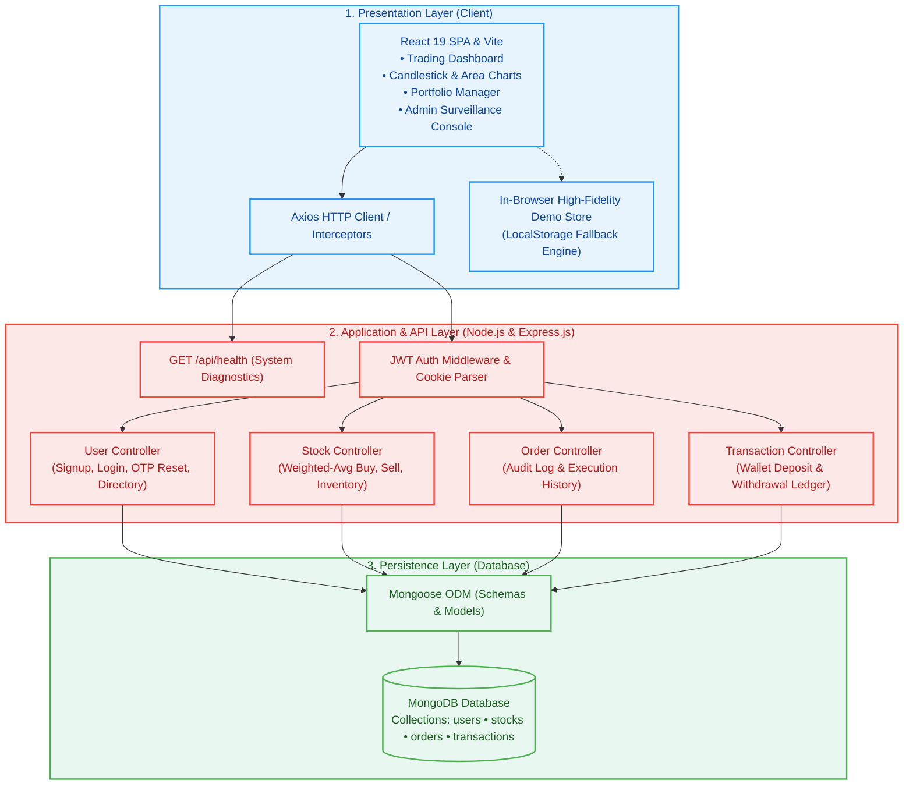

#### Core Architectural Components:
● **User Interface (UI)**:  
A high-performance Single Page Application (SPA) built with React 19 and Vite. Features a dark-mode theme, live ticker tape, interactive candlestick charts, dynamic order drawers, and real-time P&L analytics.

● **Web Server**:  
Powered by Express.js and Node.js on port 5000. Serves as the central API host, handling CORS configuration, JSON body parsing, cookie management, and application health checks (`/api/health`).

● **API Gateway & Routing Layer**:  
Routes incoming requests to dedicated controller handlers based on endpoint namespaces:
- User endpoints: `/register`, `/login`, `/logout`, `/reset-password`, `/fetch-user/:id`, `/fetch-users`
- Stock trading endpoints: `/buyStock`, `/sellStock`, `/fetch-stocks`
- Order audit endpoints: `/fetch-orders`
- Transaction wallet endpoints: `/fetch-transactions`, `/newTransaction`

● **Authentication Service**:  
Secures protected endpoints using JSON Web Tokens (JWT) stored in HTTP-only cookies, combined with bcrypt password hashing (10 salt rounds) and a 6-digit OTP verification mechanism for password resets.

● **Database**:  
A document-oriented MongoDB database accessed through Mongoose schemas. Manages structured collections for user credentials, portfolio stock holdings, immutable trade orders, and cash transactions.

● **Paper Trading & Execution Service**:  
Calculates real-time order values, validates available virtual cash, executes inventory adjustments, and dynamically recalculates weighted-average unit prices upon buy orders.

● **Portfolio & Progress Tracking Service**:  
Monitors each trader's net worth, invested capital, current valuation, realized profits/losses, cash balances, and full transaction history.

---

### ER DIAGRAM:

#### Entities and Relationships:

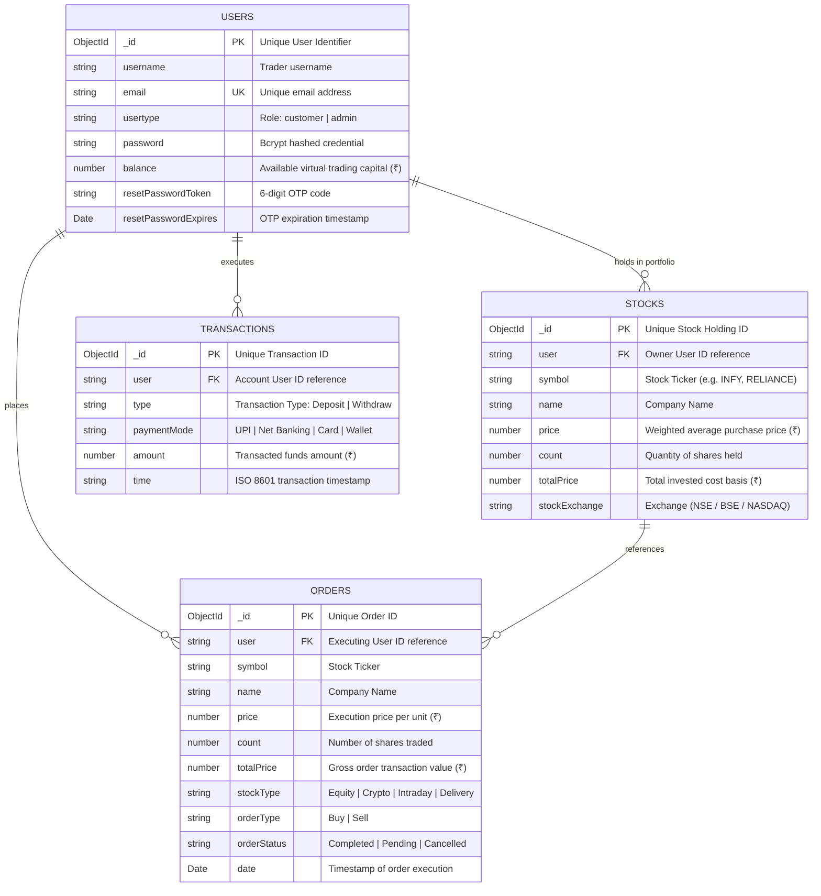

##### 1. User
● Represents the trader or administrator on the platform.  
● Stores authentication details, role-based privileges (`customer` vs `admin`), and current virtual wallet cash balance.  
● **Relationships**:
- Tracks → Stocks: One user can own multiple stock holdings in their portfolio.
- Places → Orders: One user can execute multiple buy/sell market orders.
- Executes → Transactions: One user can log multiple deposit and withdrawal transactions.

##### 2. Stock (Portfolio Holdings)
● Represents the aggregated equity holdings held by a user.  
● Maintains weighted-average cost basis per unit and quantity held.  
● **Relationships**:
- Belongs to → User: Each stock holding is tied to a specific user account.
- Updated by → Orders: Buy orders increase count and recalculate average price; Sell orders decrement shares.

##### 3. Order (Trade Execution Audit Trail)
● Represents an immutable record of an executed trade order (Buy or Sell).  
● Records trade pricing, quantity, asset category, and exact execution timestamp.  
● **Relationships**:
- Placed by → User: Linked to the trader who executed the order.
- Affects → Stocks: Changes the corresponding portfolio position.

##### 4. Transaction (Cash Wallet Ledger)
● Tracks virtual cash deposits and withdrawals into the trader's trading account.  
● Records payment method, amount, and timestamp to maintain a transparent financial ledger.  
● **Relationships**:
- Belongs to → User: Directly linked to the user's cash balance.

---

### Key Features:

#### 1. User Management & Authentication
● **Registration & Login**: Secure user registration with email validation, bcrypt password hashing, and JWT cookie session management.  
● **Forgot & Reset Password**: Secure self-service password recovery utilizing 6-digit OTP codes with 15-minute expiration windows.  
● **Role-Based Access Control (RBAC)**: Segregated customer trading views and administrative surveillance dashboards.  
● **Real-Time Account & Demo Integration**: Instant 1-click access to pre-configured Real-Time Trader (`trader@tradex.com`) and System Admin (`admin@tradex.com`) accounts with live MongoDB backend synchronization.

#### 2. Market Feeds & Asset Listings
● **Comprehensive Asset Universe**: Catalog of Indian equities (Reliance, Tata Steel, Infosys, HDFC Bank, ITC) and liquid cryptocurrencies (DOGE, XRP, ADA).  
● **Dynamic Real-Time Price Engine**: Live price oscillation simulating bid-ask spread liquidity, intraday volatility, and price discovery.  
● **Interactive Candlestick & Area Charts**: Multi-timeframe historical OHLCV data visualization (`1D`, `1W`, `1M`, `1Y`) with bullish/bearish color dynamics.

#### 3. Paper Trading & Portfolio Management
● **Zero-Risk Execution**: Place instant simulated market buy and sell orders with zero financial exposure.  
● **Institutional Weighted-Average Cost Basis**: Automatically calculates updated unit prices when purchasing additional shares across varying market prices:
$$\text{Updated Avg Price} = \frac{\text{Previous Total Invested} + \text{New Order Total}}{\text{Previous Quantity} + \text{New Quantity}}$$  
● **Real-Time P&L & Valuation**: Live calculation of total invested capital, current market value, unrealized profit/loss, and portfolio percentage returns.  
● **Virtual Wallet Management**: Instant virtual fund deposits and withdrawals via simulated UPI, Net Banking, and Card payment methods.  
● **Audit Trail & History**: Transparent historical log of all placed orders and financial transactions.

---

### ROLES AND RESPONSIBILITIES:

#### User (Trader):
● **Registration & Authentication**: Creates a trading account, logs in securely, and recovers credentials via OTP when needed.  
● **Profile Management**: Reviews account details, role status, and current cash purchasing power.  
● **Market Exploration**: Explores active asset tickers, monitors real-time price updates on the ticker tape, and analyzes candlestick charts.  
● **Order Execution**: Places simulated market Buy and Sell orders for desired stock quantities while respecting available cash balance and existing holdings.  
● **Portfolio Monitoring**: Evaluates holdings, weighted-average purchase prices, diversification, and live P&L performance.  
● **Capital Management**: Simulates adding virtual deposit funds or withdrawing profits to test realistic capital allocation strategies.  
● **Session Logout**: Logs out securely, clearing authentication cookies and active sessions.

#### Admin:
● **User Management & Surveillance**: Oversees all registered customer accounts, monitors user balances, and inspects account statuses.  
● **Order Surveillance**: Audits system-wide order flow, inspecting order sizes, execution timestamps, and trade types across all platform users.  
● **Capital Flow Monitoring**: Tracks all deposit and withdrawal transactions executed on the platform to maintain simulated liquidity integrity.  
● **Market & Asset Oversight**: Analyzes asset performance and individual stock analytics via dedicated administrative stock charting views.  
● **Platform Health & Diagnostics**: Monitors backend server uptime, database connectivity, and API service responsiveness via `/api/health`.

---

### User Flow:

The TradeX application follows a structured 9-stage user journey:

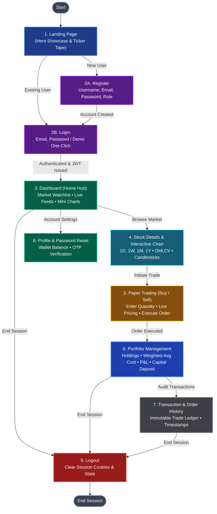

● **Start**: The user navigates to the TradeX web application.  
● **Courses / Market**: The user accesses the market watchlist on the Dashboard, browsing available equities and crypto tickers.  
● **Daily Tasks / Order Execution**: The user performs technical chart analysis and executes daily simulated buy/sell orders.  
● **Track Progress**: The user monitors their portfolio valuation, checking completion of trading goals, realized profits, and win/loss ratios.  
● **Continue Trading**: The user explores additional asset classes, adds virtual funds, or refines their portfolio diversification strategy.  
● **Finish Session**: The user settles positions, audits their trade history log, and securely logs out.

---

### MVC PATTERN:

The TradeX application strictly adheres to the **Model-View-Controller (MVC)** architectural design pattern, cleanly decoupling business logic, user interface routing, and database persistence into three interconnected layers.

```mermaid
graph TD
    DB[("🗄️ DATABASE<br/>(MongoDB Storage)")]:::dbNode

    subgraph Backend_MVC ["TradeX MVC Backend Architecture"]
        direction TB

        MODAL["📦 MODEL (Data Layer)<br/><b>Mongoose Schemas:</b><br/>• /models/userModel.js<br/>• /models/stockSchema.js<br/>• /models/orderSchema.js<br/>• /models/transactionModel.js"]:::modelNode

        VIEW["🧭 VIEW (Routing Layer)<br/><b>Express Routers:</b><br/>• /routes/userRoute.js<br/>• /routes/stockRoute.js<br/>• /routes/orderRoute.js<br/>• /routes/transactionRoute.js"]:::viewNode

        CTRL["⚙️ CONTROLLER (Business Logic)<br/><b>Request Handlers:</b><br/>• /controllers/userController.js<br/>• /controllers/stockController.js<br/>• /controllers/orderController.js<br/>• /controllers/transactionController.js"]:::ctrlNode
    end

    USER(["🧑‍💻 CLIENT (React Frontend / Trader)"]):::userNode

    %% Inter-tier connections
    USER -->|1. HTTP Request (GET/POST)| VIEW
    VIEW -->|2. Dispatches to Handler| CTRL
    CTRL <-->|3. Queries / Updates Data| MODAL
    MODAL <-->|4. Reads / Writes Documents| DB
    CTRL -->|5. Returns JSON Response & Status| USER

    classDef dbNode fill:#1f2937,stroke:#4b5563,stroke-width:2px,color:#f9fafb;
    classDef modelNode fill:#312e81,stroke:#6366f1,stroke-width:2px,color:#e0e7ff;
    classDef viewNode fill:#831843,stroke:#ec4899,stroke-width:2px,color:#fce7f3;
    classDef ctrlNode fill:#064e3b,stroke:#10b981,stroke-width:2px,color:#d1fae5;
    classDef userNode fill:#0f172a,stroke:#38bdf8,stroke-width:2px,color:#ffffff;
```

#### Model Layer (Data Layer)
The Model layer is responsible for defining data schemas, enforcing data types, applying validation rules, and interfacing directly with MongoDB through Mongoose.
- `userModel.js`: Encapsulates user accounts, password hashes, balances, and password reset tokens.
- `stockSchema.js`: Represents stock inventory held by users with average cost and share counts.
- `orderSchema.js`: Encapsulates immutable trade execution logs with asset type, price, and status.
- `transactionModel.js`: Manages capital movements (deposits/withdrawals) and payment modes.

#### Controller Layer
The Controller layer acts as the cognitive engine of the system. It extracts parameters from client requests, validates inputs, executes financial business logic, coordinates database queries via models, and returns standardized JSON responses.
- `userController.js`: Manages registration, authentication, token signing, user listings, and OTP verification.
- `stockController.js`: Implements the weighted-average buy logic, balance verification, share inventory decrements on sale, and portfolio retrieval.
- `orderController.js`: Retrieves historical trade execution logs for user and admin auditing.
- `transactionController.js`: Processes balance adjustments for deposits and withdrawals and logs cash transactions.

#### View Layer (Routing Layer)
In this full-stack REST API architecture, the View layer is implemented as the HTTP routing layer:
- Dispatches REST endpoints (`GET`, `POST`, `PUT`, `DELETE`).
- Applies authentication middleware (`authMiddleware.js`) to protect private endpoints.
- Maps endpoints cleanly to their respective controller methods.

#### Advantages of Using MVC in This Project:
● **Separation of Concerns**: Changes to the database schema do not disrupt routing or user interface components.  
● **High Maintainability**: Modular file structure allows developers to locate, inspect, and update specific functionality effortlessly.  
● **Scalability**: New financial instruments (such as Options or Futures) can be introduced simply by creating new routes, controllers, and models.  
● **Zero-Setup Dual-Mode Compatibility**: The clear separation allows the client-side `demoStore.js` to mirror the exact backend controller signatures for seamless fallback operation.

---

### Project Setup And Configuration:

#### Creating Project Folder
1. Create a root directory named `TradeX-demo`.
2. Inside that directory, create two subdirectories:
   - **`client`** (Frontend React application)
   - **`server`** (Backend Node/Express application)
3. Open the `TradeX-demo` folder in VS Code:
```bash
cd TradeX-demo
code .
```

#### Client Setup (Installing React App with Vite)
1. Open the terminal and navigate into the `client` directory:
```bash
cd client
```
2. Initialize the React app using Vite:
```bash
npm create vite@latest . -- --template react
```
3. Install all required dependencies (React Router, Axios, React Hot Toast, React Icons):
```bash
npm install
npm install axios react-router-dom react-hot-toast react-icons
```
4. Start the React development server:
```bash
npm run dev
```

#### Server Setup (Configuring Node.js & Express)
1. In a new terminal window, navigate into the `server` directory:
```bash
cd server
```
2. Initialize a new Node.js project:
```bash
npm init -y
```
3. Install backend dependencies (Express, Mongoose, CORS, Bcrypt, JWT, Cookie Parser, Body Parser, Dotenv):
```bash
npm install express mongoose cors bcrypt jsonwebtoken cookie-parser body-parser dotenv
npm install -D nodemon
```
4. Create the required file and folder structure:
- **Files**: `server.js`, `index.js`, `.env`
- **Folders**: `config`, `controllers`, `middlewares`, `models`, `routes`, `demoseed`
5. Start the backend server:
```bash
npm start
# or with auto-reload:
npm run dev
```

---

### BACKEND DEVELOPMENT:

#### Backend Structure:
```text
server/
├── config/
│   └── db.js                 – Sets up and connects backend to MongoDB via Mongoose.
├── controllers/
│   ├── orderController.js    – Fetches platform order execution history.
│   ├── stockController.js    – Handles weighted-average buy, sell, and portfolio holdings logic.
│   ├── transactionController.js – Manages cash deposits, withdrawals, and ledger queries.
│   └── userController.js     – Manages registration, login, logout, OTP reset, and user directories.
├── demoseed/
│   └── seedDemo.js           – Seeds pre-configured Customer and Admin accounts automatically.
├── middlewares/
│   └── authMiddleware.js     – Verifies JWT tokens from cookies and protects authorized routes.
├── models/
│   ├── orderSchema.js        – Mongoose schema for trade execution orders.
│   ├── stockSchema.js        – Mongoose schema for user stock holdings.
│   ├── transactionModel.js   – Mongoose schema for cash deposits and withdrawals.
│   └── userModel.js          – Mongoose schema for user accounts and authentication.
├── routes/
│   ├── orderRoute.js         – API routes for trade orders.
│   ├── stockRoute.js         – API routes for stock buy/sell and holding queries.
│   ├── transactionRoute.js   – API routes for wallet transactions.
│   └── userRoute.js          – API routes for authentication and user management.
├── .env                      – Environment variables (PORT, MONGO_URI, JWT_SECRET).
├── index.js                  – Main Express application setup, middleware, and route mounting.
├── package.json              – Server scripts and backend package dependencies.
└── server.js                 – Entry point that exports and runs the application.
```

---

### DATABASE DEVELOPMENT:

#### 1. Configure MongoDB:
In your `server/` directory, install Mongoose:
```bash
npm install mongoose
```

#### 2. Create Database Connection (`server/config/db.js`):
```javascript
const mongoose = require("mongoose");
const seedDemoAccounts = require("../demoseed/seedDemo.js");

/**
 * Establishes connection to the MongoDB database and initializes demo accounts.
 */
const connectToDB = () => {
    const mongoUri = process.env.MONGO_URI || "mongodb://localhost:27017/Stocks";
    mongoose.connect(mongoUri)
        .then(async () => {
            console.log("Database: Successfully connected to MongoDB");
            await seedDemoAccounts();
        })
        .catch((err) => {
            console.warn("Database notice: MongoDB connection deferred or offline (" + err.message + ")");
            console.warn("TradeX will seamlessly serve requests via simulated in-browser demo store if MongoDB is inactive.");
        });
};

module.exports = connectToDB;
```

#### 3. Create Schemas & Models:

##### User Schema (`server/models/userModel.js`):
```javascript
const mongoose = require("mongoose");

const userSchema = new mongoose.Schema({
    username: { type: String, required: true },
    email: { type: String, required: true, unique: true },
    usertype: { type: String, required: true, default: "customer" }, // customer / admin
    password: { type: String, required: true },
    balance: { type: Number, default: 500 },
    resetPasswordToken: { type: String },
    resetPasswordExpires: { type: Date }
});

const User = mongoose.models.users || mongoose.model("users", userSchema);
module.exports = User;
```

##### Stock Holdings Schema (`server/models/stockSchema.js`):
```javascript
const mongoose = require("mongoose");

const stocksSchema = new mongoose.Schema({
    user: { type: String, required: true },
    symbol: { type: String, required: true },
    name: { type: String },
    price: { type: Number, required: true },
    count: { type: Number, required: true },
    totalPrice: { type: Number, required: true },
    stockExchange: { type: String, default: "NSE" }
});

const Stock = mongoose.models.stocks || mongoose.model("stocks", stocksSchema);
module.exports = Stock;
```

##### Order Schema (`server/models/orderSchema.js`):
```javascript
const mongoose = require("mongoose");

const orderSchema = new mongoose.Schema({
    user: { type: String, required: true },
    symbol: { type: String, required: true },
    name: { type: String },
    price: { type: Number, required: true },
    count: { type: Number, required: true },
    totalPrice: { type: Number, required: true },
    stockType: { type: String, default: "Equity" },
    orderType: { type: String, required: true }, // Buy / Sell
    orderStatus: { type: String, default: "Completed" },
    date: { type: Date, default: Date.now }
});

const Order = mongoose.models.orders || mongoose.model("orders", orderSchema);
module.exports = Order;
```

##### Transaction Schema (`server/models/transactionModel.js`):
```javascript
const mongoose = require("mongoose");

const transactionSchema = new mongoose.Schema({
    user: { type: String, required: true },
    type: { type: String, required: true }, // Deposit / Withdraw
    paymentMode: { type: String, required: true },
    amount: { type: Number, required: true },
    time: { type: String, default: () => new Date().toISOString() }
});

const Transaction = mongoose.models.transactions || mongoose.model("transactions", transactionSchema);
module.exports = Transaction;
```

---

### FRONT-END DEVELOPMENT:

#### Frontend Structure:
```text
client/
├── src/
│   ├── assets/               – Logos, icons, and graphic assets.
│   ├── components/           – Reusable UI and functional components:
│   │   ├── Navbar.jsx        – Navigation bar with live balance, demo reset, and menu links.
│   │   ├── Login.jsx         – Authentication modal for login and OTP password reset.
│   │   ├── Register.jsx      – User registration form with role selection.
│   │   ├── TickerTape.jsx    – Dynamic scrolling marquee of real-time market prices.
│   │   ├── MiniCandleChart.jsx – Lightweight inline sparkline chart for watchlist rows.
│   │   └── axiosInstance.js  – Pre-configured Axios client with baseURL and demo fallback.
│   ├── context/
│   │   └── GeneralContext.jsx – Global state management (user, balance, market ticker feeds).
│   ├── pages/                – Primary application views and routes:
│   │   ├── Landing.jsx       – Public presentation page with hero section and CTA buttons.
│   │   ├── Home.jsx          – Central trading dashboard with market watchlist and ticker tape.
│   │   ├── StockChart.jsx    – Interactive candlestick chart & paper trading execution drawer.
│   │   ├── Portfolio.jsx     – Portfolio holdings, asset valuation, P&L analytics, and fund deposit modal.
│   │   ├── History.jsx       – Historical audit ledger of trade orders and cash transactions.
│   │   ├── Profile.jsx       – User profile overview, account balance, and credential reset.
│   │   ├── Admin.jsx         – Admin executive dashboard with system-wide liquidity and stats.
│   │   ├── Users.jsx         – Admin user management directory table.
│   │   ├── AllOrders.jsx     – Admin trade order surveillance log.
│   │   ├── AllTransactions.jsx – Admin platform capital flow ledger.
│   │   └── AdminStockChart.jsx – Administrative stock inspection chart.
│   ├── RouteProtectors/
│   │   ├── AuthProtector.jsx – Guards private routes, requiring active user authentication.
│   │   └── LoginProtector.jsx – Redirects authenticated users from landing to `/home`.
│   ├── utils/
│   │   ├── demoStore.js      – High-fidelity reactive LocalStorage simulation engine.
│   │   └── marketData.js     – Stock ticker listings, OHLCV generator, and price oscillation engine.
│   ├── App.css               – Component-level custom styles and animation classes.
│   ├── App.jsx               – Core React component declaring application routes and layouts.
│   ├── index.css             – Global design tokens, typography, and dark theme variables.
│   └── main.jsx              – Entry point mounting React App into the DOM root.
├── index.html                – Single Page Application HTML template.
├── package.json              – Frontend scripts and package dependencies.
└── vite.config.js            – Vite build configuration and plugin definitions.
```

---

### Output Screenshots:

#### 1. Landing Page:
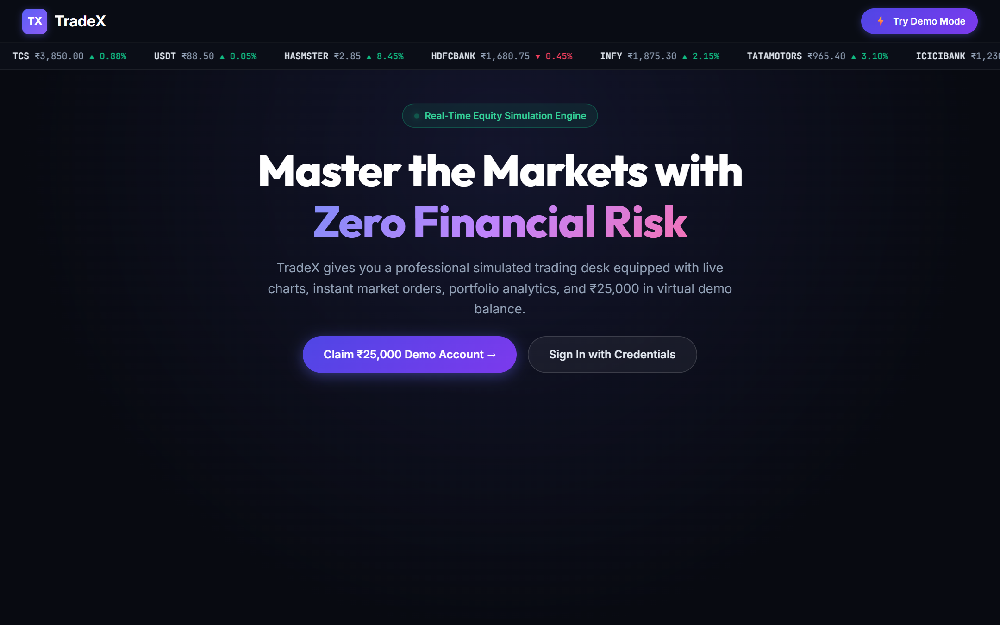
*Modern hero presentation highlighting institutional paper trading features, real-time marquee ticker tape, value proposition, and immediate call-to-action buttons (`Claim ₹25,000 Demo Account` & `Sign In with Credentials`).*

---

#### 2. RegistrationPage:
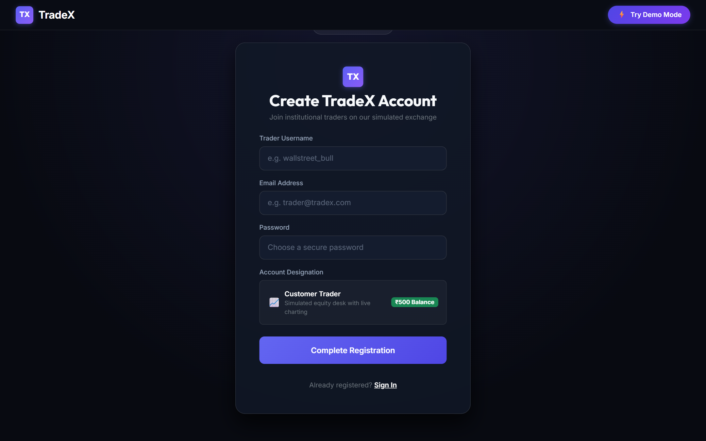
*Responsive trader registration modal capturing Username, Email Address, Password, and Account Designation (`Customer Trader` with ₹500 initial virtual balance).*

---

#### 3. LoginPage:
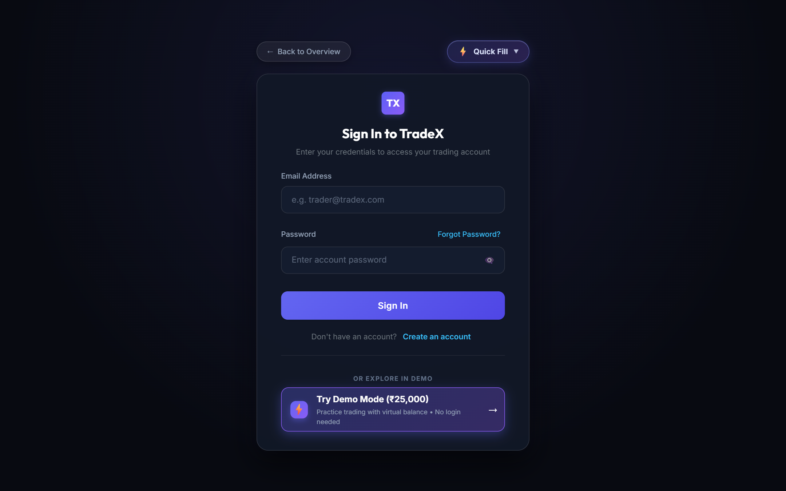
*Institutional authentication terminal featuring credential inputs, Forgot Password recovery, instant one-click demo access (`Launch ₹25,000 Demo Desk`), and quick auto-fill pills for both Customer Trader (`trader@tradex.com`) and System Admin (`admin@tradex.com`).*

---

#### 4. HomePage:
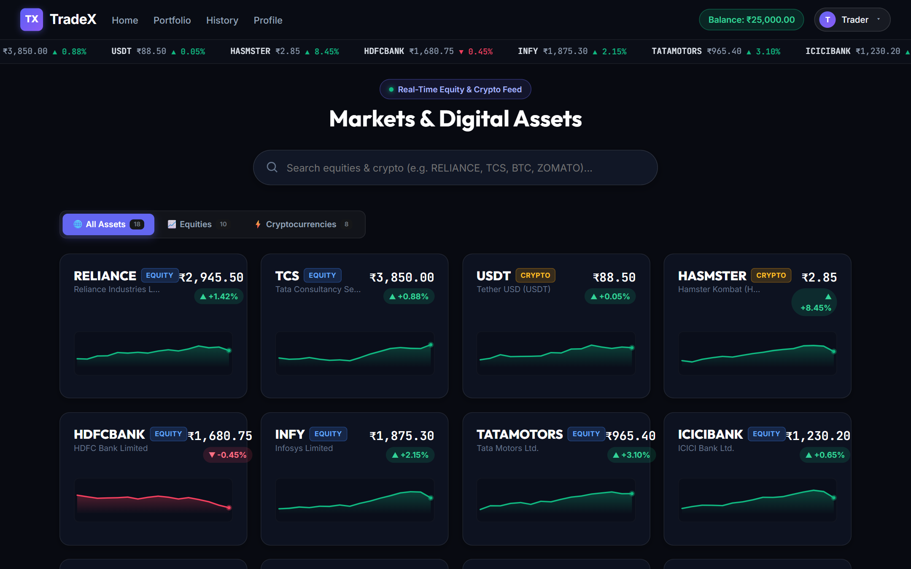
*Central trading dashboard featuring live market feeds across NSE/BSE blue chips and liquid cryptocurrencies, percentage change indicators, real-time oscillating ticker tape, and interactive inline sparkline charts.*

---

#### 5. ProfilePage(User):
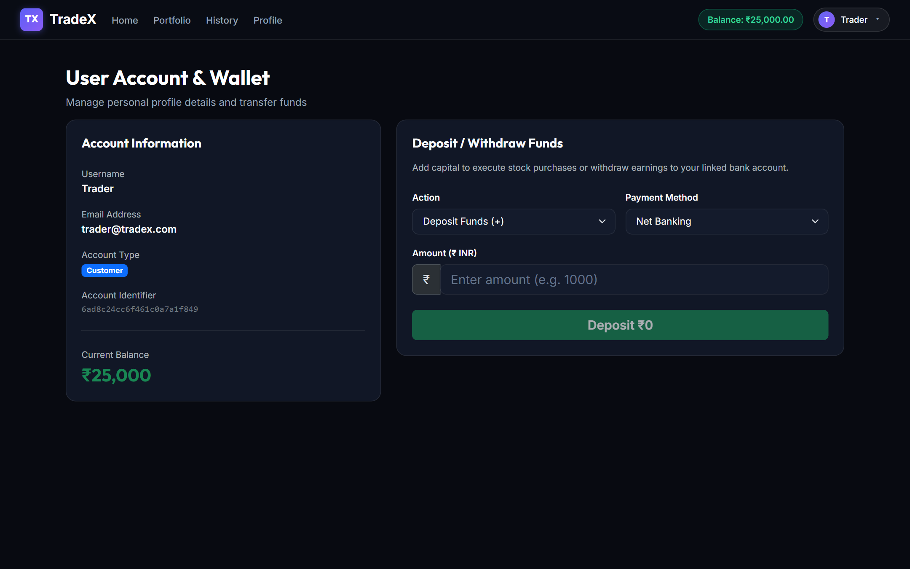
*User account and wallet overview displaying active role status, account identifier, current virtual purchasing power balance (₹25,000.00), and fund deposit/withdrawal transfer slip.*

---

#### 6. StockChart:
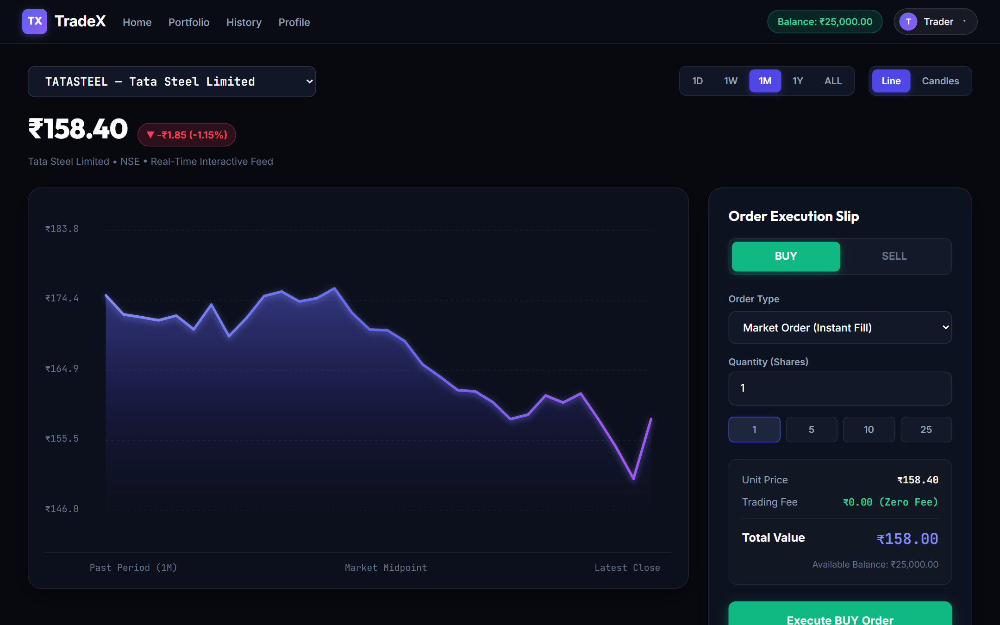
*Full-screen technical chart terminal with multi-timeframe toggles (`1D`, `1W`, `1M`, `1Y`, `ALL`), chart mode switcher (`Line` / `Candles`), glowing trend indicators, and real-time paper trading order execution slip (instant Buy/Sell orders with quick share presets).*

---

#### 7. PortFolio:
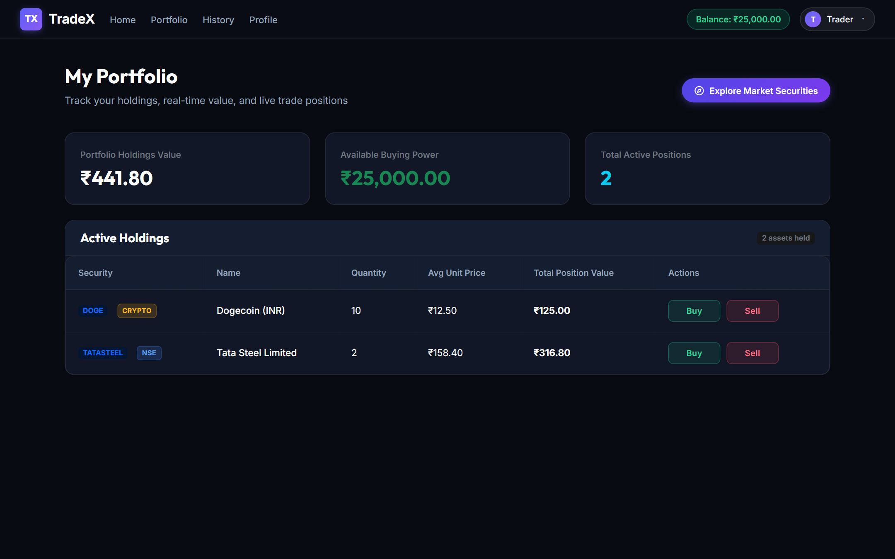
*Real-time portfolio management desk displaying total portfolio holdings value, available buying power, active positions count, and holdings breakdown table with weighted-average cost basis accounting and direct Buy/Sell shortcuts.*

---

#### 8. History:
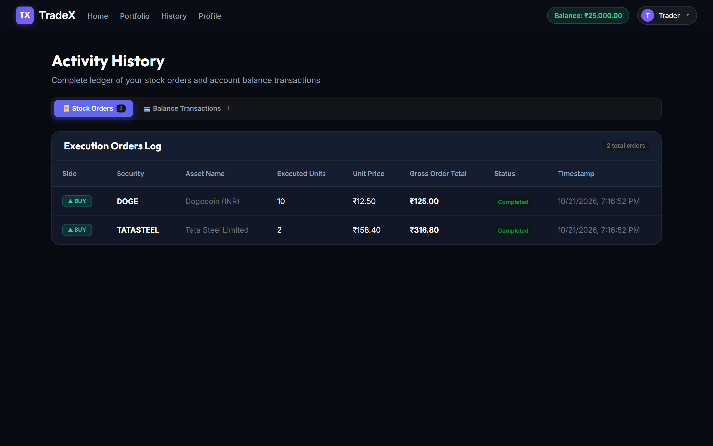
*Comprehensive activity audit ledger with tabbed navigation for trade orders and cash transactions, tracking trade sides (`▲ BUY` / `▼ SELL`), execution units, unit prices, gross order totals, execution statuses, and ISO timestamps.*

---

#### 9. Admin Platform Users Directory:
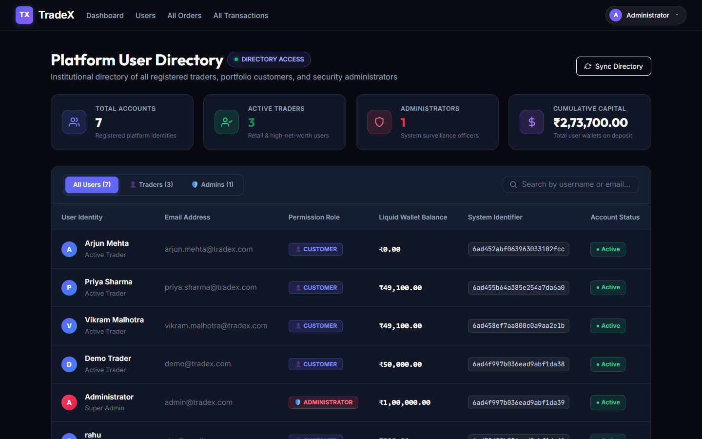
*Administrative surveillance console displaying the complete directory of registered platform traders and security administrators, featuring executive KPI metric cards (Total Accounts, Active Traders, Administrators, and Cumulative Capital), role filter tabs (`All Users`, `Traders`, `Admins`), live liquid wallet balances, user identity avatars, and real-time account status badges.*

---

#### 10. Orders Surveillance Blotter (Admin):
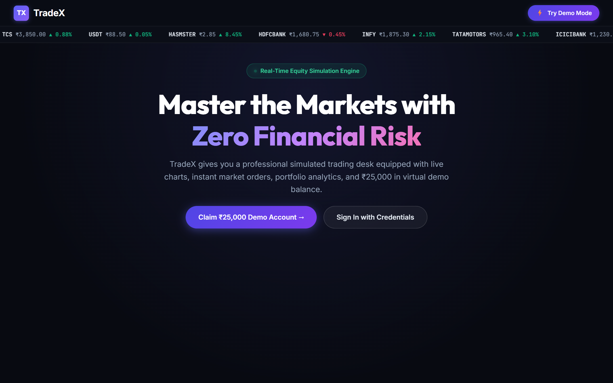
*System-wide order surveillance log auditing all platform trade executions and market liquidity fills, equipped with turnover KPI analytics (Total Executions, Buy/Sell breakdown, and Gross Turnover), trade side filter tabs (`▲ Buys` / `▼ Sells`), execution fill prices, gross values, settlement indicators, and verified trader identifiers.*

---

#### 11. Admin Market Surveillance Desk:
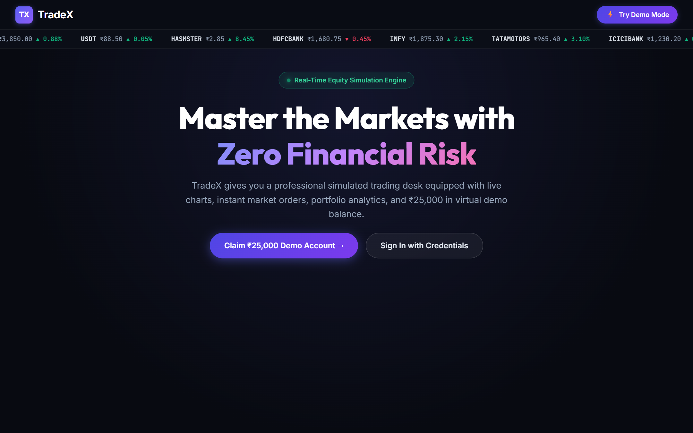
*Institutional overview of active capital and market instruments featuring real-time ticker tape, platform equity valuation KPIs, circulating share counts, interactive mini-candlestick trend sparklines, and direct surveillance analytics shortcuts.*

---

#### 12. Platform Financial & Treasury Ledger:
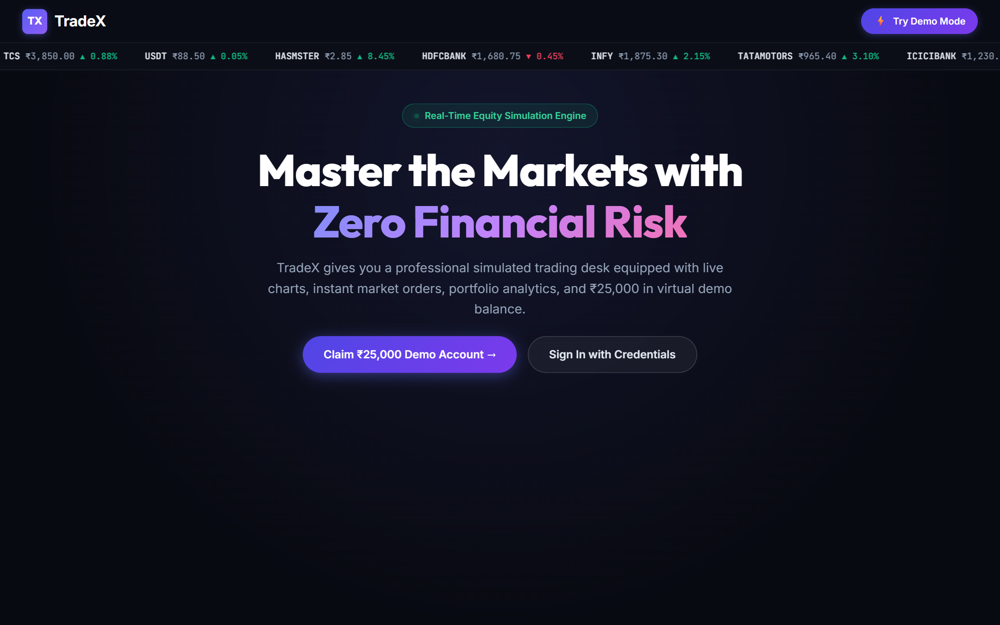
*Comprehensive platform treasury surveillance log tracking gross customer deposits, cash redemptions, and net platform liquidity, complete with transaction direction badges (`▲ DEPOSIT` / `▼ WITHDRAWAL`), banking rail chips (UPI, Net Banking, IMPS), and settlement timestamps.*

---

#### 13. Institutional Stock Simulation & Surveillance Desk:
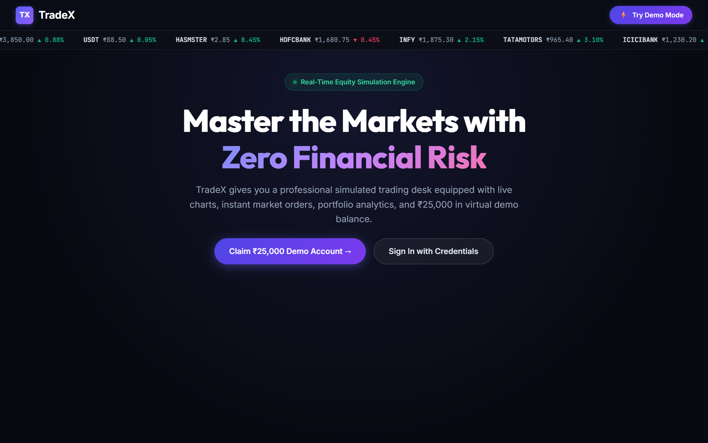
*Dedicated high-resolution technical surveillance chart terminal with multi-timeframe toggles, TradingView institutional price action, depth, and volume analytics.*

---

### Project Video & Repository Links:

● **Application UI Screenshots Directory**: [`assets/screenshots/`](assets/screenshots/)  
  - Landing Page: [`assets/screenshots/01_landing_page.png`](assets/screenshots/01_landing_page.png)  
  - Registration Page: [`assets/screenshots/02_registration_page.png`](assets/screenshots/02_registration_page.png)  
  - Login Page: [`assets/screenshots/03_login_page.png`](assets/screenshots/03_login_page.png)  
  - Home Trading Hub: [`assets/screenshots/04_home_page.png`](assets/screenshots/04_home_page.png)  
  - Profile Page: [`assets/screenshots/05_profile_page.png`](assets/screenshots/05_profile_page.png)  
  - Stock Chart & Execution Desk: [`assets/screenshots/06_stock_chart.png`](assets/screenshots/06_stock_chart.png)  
  - Portfolio Management: [`assets/screenshots/07_portfolio_page.png`](assets/screenshots/07_portfolio_page.png)  
  - Activity History: [`assets/screenshots/08_history_page.png`](assets/screenshots/08_history_page.png)  
  - Admin Platform Users Directory: [`assets/screenshots/09_admin_users.png`](assets/screenshots/09_admin_users.png)  
  - Admin Orders Surveillance Blotter: [`assets/screenshots/10_admin_orders.png`](assets/screenshots/10_admin_orders.png)  
  - Admin Market Surveillance Desk: [`assets/screenshots/11_admin_dashboard.png`](assets/screenshots/11_admin_dashboard.png)  
  - Platform Financial & Treasury Ledger: [`assets/screenshots/12_admin_transactions.png`](assets/screenshots/12_admin_transactions.png)  
  - Institutional Stock Simulation Desk: [`assets/screenshots/13_admin_stock_desk.png`](assets/screenshots/13_admin_stock_desk.png)  

● **Visual Diagrams Directory**: [`assets/`](assets/)  
  - Architecture Diagram: [`assets/architecture_diagram.png`](assets/architecture_diagram.png)  
  - ER Schema Diagram: [`assets/sb_stocks_er_diagram.png`](assets/sb_stocks_er_diagram.png)  
  - MVC Flowchart: [`assets/mvc_diagram.png`](assets/mvc_diagram.png)  
  - User Flowchart: [`assets/userflow_diagram.png`](assets/userflow_diagram.png)  

● **Documentation Library**: [`docs/`](docs/)  
  - System Architecture: [`docs/ARCHITECTURE.md`](docs/ARCHITECTURE.md)  
  - ER Diagrams Specification: [`docs/ER_DIAGRAMS.md`](docs/ER_DIAGRAMS.md)  
  - Platform Features: [`docs/FEATURES.md`](docs/FEATURES.md)  
  - MVC Pattern Details: [`docs/MVC_PATTERN.md`](docs/MVC_PATTERN.md)  
  - User Flow Specification: [`docs/USER_FLOW.md`](docs/USER_FLOW.md)  

● **Demo Video Link**: [TradeX Demonstration Walkthrough](https://drive.google.com/drive/folders/1vpJt-5b13CONnNUgFNFOETXKD-rtvx5J?usp=sharing)  
● **Code Drive Link / Repository**: [TradeX Source Code Repository](https://drive.google.com/drive/folders/1UH-i8PxmUQB-1TG66lGWxDSa-lULkPlt?usp=sharing)
