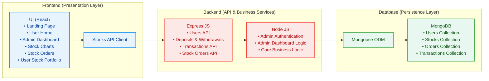
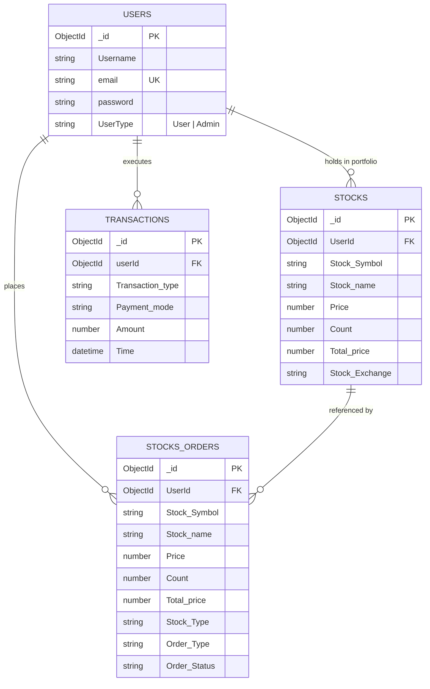
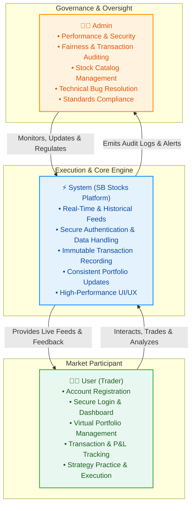
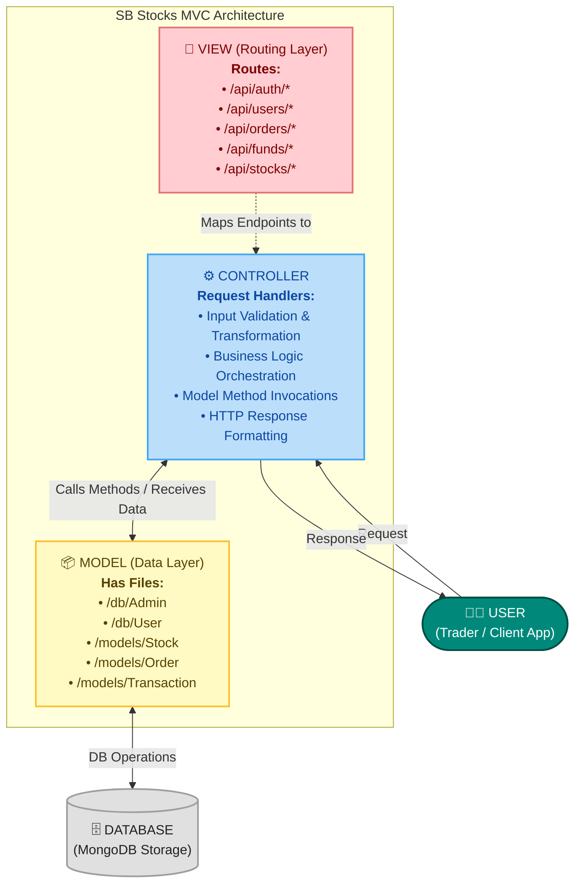
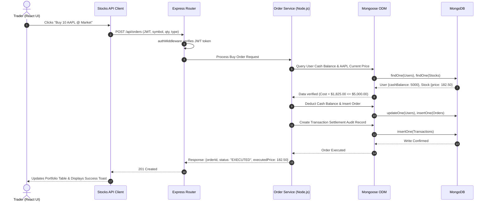

# TradeX — System Architecture Specification

This document defines the architectural blueprints, system tier responsibilities, component communication protocols, and data persistence models for **TradeX** — an end-to-end stock trading simulation and virtual portfolio management platform.

---

## 🏛️ Architecture Overview

TradeX follows a decoupled 3-tier architecture separating concerns between user presentation, business logic orchestration, and data persistence:

### 📐 Visual Architecture Diagram

---

## 🏗️ Architectural Tier Responsibilities

### 1. 🖥️ Frontend Section
The frontend is represented by the **"Frontend"** section, built in **React**, delivering an interactive single-page application (SPA). It includes the following core user interface components:

| Component | Responsibility | Key Features |
| :--- | :--- | :--- |
| **Landing Page** | Platform gateway and value proposition | Public market overview, platform feature summaries, quick registration/login access points. |
| **User Home** | Trader command dashboard | Watchlist widgets, top market movers (gainers/losers), wallet cash summary, quick-trade buttons. |
| **Admin Dashboard** | Operations & governance center | Global trader metrics, user account status management, liquidity oversight, platform audit logs. |
| **Stock Charts** | Interactive technical charting | Candlestick and line charts with multi-timeframe toggles (1D, 1W, 1M, 1Y), volume bars, and OHLCV overlays. |
| **Stock Orders** | Trade execution interface | Market and limit order ticket slips, buy/sell toggles, live cost estimators, and order validation. |
| **User Stock Portfolio** | Investment holdings tracker | Real-time position tables, average cost basis, current market value, asset distribution charts, and realized/unrealized P&L. |
| **Stocks API Client** | Data abstraction layer | Centralized client module querying backend quote services, external market data feeds, and trading endpoints. |

---

### 2. ⚙️ Backend Section
The backend is represented by the **"Backend"** section, developed with **Express.js** running on the **Node.js** runtime. It handles HTTP routing, request parsing, authentication, validation, and transaction consistency.

#### Core Functional API Endpoints:

#### A. Users API
- `POST /api/auth/register` — Trader onboarding, password encryption (`bcryptjs`), and profile initialization.
- `POST /api/auth/login` — Authentication and JWT token issuance.
- `GET /api/users/profile` — Fetch authenticated trader profile, preferences, and permissions.
- `PUT /api/users/profile` — Update trader personal information.

#### B. Deposits and Withdrawal of Funds
- `GET /api/funds/balance` — Query live cash balance available for trading.
- `POST /api/funds/deposit` — Simulate cash deposit into the trader's cash wallet.
- `POST /api/funds/withdraw` — Withdraw cash from wallet with overdraft validation.

#### C. Transactions API
- `GET /api/transactions` — Retrieve user transaction ledger (deposits, withdrawals, stock buys, stock sells).
- `GET /api/transactions/:id` — Fetch detailed transaction audit slip with timestamp and settlement status.

#### D. Stock Orders API
- `POST /api/orders` — Submit new Market or Limit orders (BUY / SELL) with balance verification.
- `GET /api/orders` — List active, filled, or cancelled orders for the authenticated user.
- `GET /api/orders/:id` — Inspect individual order state and execution details.
- `PUT /api/orders/:id/cancel` — Cancel pending limit orders.

#### E. Admin Authentication & Admin Dashboard
- `POST /api/admin/auth/login` — Dedicated administrator authentication with elevated JWT scopes.
- `GET /api/admin/dashboard/stats` — Aggregate metrics: total registered users, global order volume, platform liquidity, and trade volume.
- `GET /api/admin/users` — Search, inspect, and filter user accounts across the system.
- `PUT /api/admin/users/:id/status` — Suspend or reactivate user accounts.
- `GET /api/admin/transactions` — Cross-platform transaction audit log.

---

### 3. 🗄️ Database Section
The Database section represents the database layer that persists all platform records using **MongoDB** (NoSQL Document Store) accessed through **Mongoose ODM**. It manages four core collections: **Users**, **Stocks**, **Transactions**, and **Orders** (Stocks Orders).

#### 📊 SB Stocks Entity-Relationship (ER) Diagram

The **SB Stocks ER Diagram** acts as the structural foundation of the system, clearly showcasing how different entities are connected and interact with one another. At the center of the diagram are key entities such as **Users**, **Stocks**, **Transactions**, **Portfolios**, and **Market Data**. Each User is uniquely identified within the system and can create and manage multiple Virtual Portfolios. These portfolios are designed to hold a variety of Stocks, enabling users to diversify their simulated investments.

The **Transaction** entity plays a critical role by recording every buy or sell action performed by the user. Each transaction is directly linked to both a User (who initiates the action) and a Stock (being traded), ensuring a clear trace of trading activity. The **Market Data** entity enriches the system by providing both real-time stock prices and historical performance data, which support informed decision-making and accurate trading simulations.

The relationships between these entities highlight the depth and realism of the system. For example, one user can execute multiple transactions, and a single stock can exist simultaneously in numerous portfolios, reflecting real-world trading dynamics. This interconnected framework allows users not only to buy and sell stocks but also to monitor portfolio growth, test diverse trading strategies, and learn the intricacies of stock trading in a risk-free environment. Ultimately, the ER diagram captures the core essence of SB Stocks: a well-structured, interactive simulation that bridges learning and practice by modeling realistic market relationships.

##### Visual ER Schema Diagram

##### Schema & Entity Relationships

> [!NOTE]
> For the comprehensive attribute dictionary, field constraint tables, and relational lifecycle mechanics, refer to the dedicated **[SB Stocks ER Diagrams Specification](ER_DIAGRAMS.md)**.

#### Collections Breakdown:
1. **`Users` Collection**: Stores trader credentials (`Username`, `email`, `password`), role permissions (`UserType`), and authentication profile.
2. **`Stocks` Collection**: Tracks active holdings in user virtual portfolios (`Stock Symbol`, `Stock name`, `Price`, `Count`, `Total price`, `Stock Exchange`).
3. **`Stocks Orders` Collection**: Records buy and sell order tickets, fulfillment status (`PENDING`, `EXECUTED`, `CANCELLED`), order type, and execution amounts.
4. **`Transactions` Collection**: Comprehensive immutable ledger of all financial activities (`Transaction type`, `Payment mode`, `Amount`, `Time`).

---

## 👥 Rules and Responsibilities

The TradeX (SB Stocks Platform) ecosystem is driven by three primary operational pillars: the **User (Trader)**, the **System (SB Stocks Platform)**, and the **Admin**. Each entity has clearly defined operational rules, capabilities, and governance responsibilities to ensure an authentic, secure, and resilient trading simulation experience.

### 📋 High-Level Responsibility Matrix

| Entity | Primary Domain | Core Responsibilities |
| :--- | :--- | :--- |
| **1. User (Trader)** | Trading Simulation & Portfolio Growth | • Register and create an account. • Login securely and access trading dashboard. • Create and manage multiple virtual portfolios. • Track transactions, monitor stock performance, and analyze portfolio growth. • Use real-time and historical stock data to practice strategies. |
| **2. System (SB Stocks Platform)** | Market Execution, Data Feeds & Security | • Provide real-time stock prices and historical market data. • Ensure secure registration, login, and user data handling. • Record and manage all transactions linked to users and stocks. • Maintain consistency and accuracy in portfolio updates. • Deliver a smooth, fast, and user-friendly interface. |
| **3. Admin** | Governance, Platform Health & Compliance | • Manage overall application performance and security. • Monitor user activity and transactions for fairness. • Update and maintain stock listings and market data sources. • Handle technical issues, bugs, and data accuracy. • Ensure compliance with trading simulation standards. |

---

### 1. 🧑‍💻 User (Trader)

Traders are the primary active participants within the simulation platform. Their interactions focus on market learning, order execution, and portfolio optimization.

- **Register and Create an Account**: Complete onboarding by setting up unique credentials with email validation and profile setup.
- **Login Securely and Access Trading Dashboard**: Authenticate through JWT-protected entry points to reach a personalized command center displaying cash balances, active holdings, and market trends.
- **Create and Manage Multiple Virtual Portfolios**: Organize capital across distinct thematic portfolios (e.g., Value, Growth, Dividends) to diversify risk and benchmark performance.
- **Track Transactions, Monitor Stock Performance, and Analyze Portfolio Growth**: Review historical trade ledgers, monitor price movements, calculate real-time unrealized/realized P&L, and evaluate ROI over time.
- **Use Real-Time and Historical Stock Data to Practice Strategies**: Leverage live quotes, multi-timeframe OHLCV charts, and market indicators to test short-term swing trades or long-term investment models without financial risk.

---

### 2. ⚡ System (SB Stocks Platform)

The platform engine orchestrates the underlying business logic, market feed ingestions, state synchronizations, and client delivery.

- **Provide Real-Time Stock Prices and Historical Market Data**: Stream accurate market prices, quotes, and multi-period historical time-series data for simulated analysis and realistic order matching.
- **Ensure Secure Registration, Login, and User Data Handling**: Enforce password salting and hashing (`bcryptjs`), stateless session token verification (`JWT`), and robust validation to protect user data.
- **Record and Manage All Transactions Linked to Users and Stocks**: Maintain an immutable, double-entry audit ledger associating every buy, sell, deposit, and withdrawal with specific user accounts and stock assets.
- **Maintain Consistency and Accuracy in Portfolio Updates**: Execute atomic database transactions across User balances, Orders, and Stock holdings to eliminate race conditions and balance discrepancies.
- **Deliver a Smooth, Fast, and User-Friendly Interface**: Render interactive single-page application views (React), responsive data tables, low-latency search filters, and fluid charting visualizations.

---

### 3. 👨‍💼 Admin

Administrators are responsible for platform integrity, security enforcement, liquidity calibration, and operational stability.

- **Manage Overall Application Performance and Security**: Oversee server health, database query response times, rate limiting, and API endpoint availability.
- **Monitor User Activity and Transactions for Fairness**: Audit user trading patterns, order volumes, and financial flows to identify suspicious activity and preserve simulated market fairness.
- **Update and Maintain Stock Listings and Market Data Sources**: Add, update, or delist tickers, configure exchange coverage (NYSE, NASDAQ), and manage external API market data providers.
- **Handle Technical Issues, Bugs, and Data Accuracy**: Resolve system exceptions, investigate anomalies in stock quotes or portfolio valuations, and roll out software patches.
- **Ensure Compliance with Trading Simulation Standards**: Enforce simulation guidelines, margin/leverage constraints, and academic/training benchmark standards.

---

## 🧩 Backend Model-View-Controller (MVC) Pattern

The backend of the SB Stocks application follows the **Model-View-Controller (MVC)** architectural pattern, a software design approach that separates an application into three interconnected layers. This separation allows for modularity, easier maintenance, and scalability.

### 📐 Visual MVC Architecture Diagram

### 🔄 Interactive Flowchart

### Layer Roles & Responsibilities

- **Model Layer (Data Layer)**: The Model layer is responsible for handling all data-related logic. This includes the definition of data schemas and the operations performed on the database using those schemas. The models are implemented using Mongoose, which provides a schema-based solution to model application data for MongoDB. Has files: `/db/Admin`, `/db/User`, `/models/Stock.js`, `/models/Order.js`, `/models/Transaction.js`.
- **Controller Layer**: The Controller layer acts as an intermediary between the view (routes) and the model. It receives incoming requests, processes the input (which may include validation or transformation), calls the appropriate methods from the model, and then returns a response to the client.
- **View Layer (Routing Layer)**: In the context of a backend REST API, the View is implemented as the routing layer, where various endpoints are defined. These endpoints determine how the backend responds to different HTTP requests (GET, POST, PUT, DELETE) and are responsible for invoking the appropriate controller functions.

### Advantages of Using MVC in This Project

- **Separation of Concerns**: Each layer has a clearly defined responsibility, improving readability and maintainability.
- **Scalability**: New features can be added easily by creating new routes, controllers, and models.
- **Reusability**: Logic in controllers and models can be reused across multiple parts of the application.
- **Testing**: Each layer can be tested independently, especially the controllers and models.
- **Collaboration-Friendly**: Multiple developers can work simultaneously on different layers without conflict.

> [!TIP]
> For the comprehensive specification including route-to-controller tables and schema details, see the dedicated **[SB Stocks MVC Pattern Specification](MVC_PATTERN.md)**.

---

## 🔄 End-to-End Request Lifecycle

### Stock Order Placement & Execution Flow

---

## 🔗 Related Documentation

- **[README.md](../README.md)**: Main project setup, directory layout, and quickstart instructions.
- **[SB Stocks MVC Pattern](MVC_PATTERN.md)**: Model-View-Controller design architecture, routing/controller mappings, and schema operations.
- **[Platform Features Specification](FEATURES.md)**: Exhaustive catalog of functional capabilities, trader personas, and UX flows.
- **[SB Stocks ER Diagram](ER_DIAGRAMS.md)**: Visual relational schema, entity attribute dictionary, and simulation lifecycle mechanics.
- **[SB Stocks User Flow](USER_FLOW.md)**: End-to-end 9-stage trader journey, interactive flowchart, and state transition matrix.
