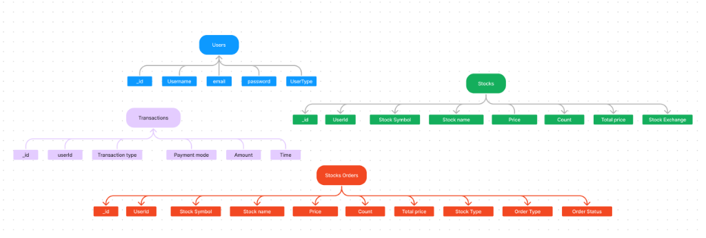
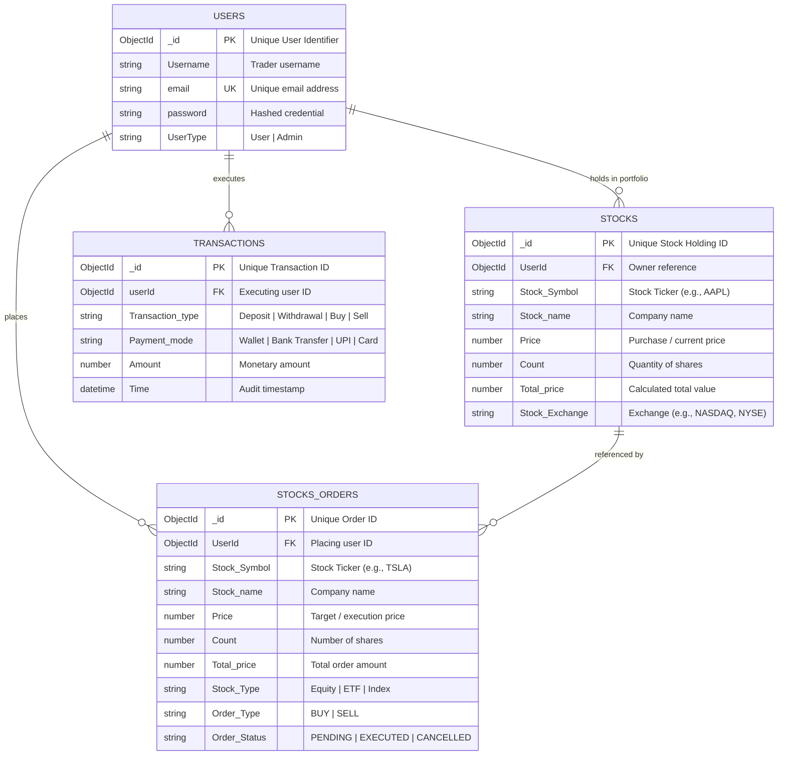

# TradeX — SB Stocks Entity-Relationship (ER) Diagrams

The **SB Stocks ER Diagram** acts as the structural foundation of the system, clearly showcasing how different entities are connected and interact with one another. At the center of the diagram are key entities such as **Users**, **Stocks**, **Transactions**, **Portfolios**, and **Market Data**. Each User is uniquely identified within the system and can create and manage multiple Virtual Portfolios. These portfolios are designed to hold a variety of Stocks, enabling users to diversify their simulated investments.

The **Transaction** entity plays a critical role by recording every buy or sell action performed by the user. Each transaction is directly linked to both a User (who initiates the action) and a Stock (being traded), ensuring a clear trace of trading activity. The **Market Data** entity enriches the system by providing both real-time stock prices and historical performance data, which support informed decision-making and accurate trading simulations.

The relationships between these entities highlight the depth and realism of the system. For example, one user can execute multiple transactions, and a single stock can exist simultaneously in numerous portfolios, reflecting real-world trading dynamics. This interconnected framework allows users not only to buy and sell stocks but also to monitor portfolio growth, test diverse trading strategies, and learn the intricacies of stock trading in a risk-free environment. Ultimately, the ER diagram captures the core essence of SB Stocks: a well-structured, interactive simulation that bridges learning and practice by modeling realistic market relationships.

---

## 📐 Visual ER Schema Diagram

The diagram below outlines the primary data collections, attributes, and hierarchical entity structures defined in the SB Stocks simulation database:

---

## 📊 Schema & Entity Relationships

The interactive Mermaid entity-relationship diagram below maps out the entities, their structural attributes, foreign key dependencies, and relational cardinalities:

---

## 📋 Comprehensive Entity-Attribute Dictionary

### 1. `Users` Entity
The `Users` collection represents individual registered traders and platform administrators. It establishes identity, security authentication, and ownership of virtual portfolios and transactions.

| Attribute | Data Type | Key / Constraint | Description | Example Value |
| :--- | :--- | :--- | :--- | :--- |
| `_id` | `ObjectId` | **Primary Key (PK)** | System-generated unique identifier | `ObjectId("652c1e8b7a9f1b001a1c4e01")` |
| `Username` | `String` | Required | Unique display handle of the trader | `"alex_trader"` |
| `email` | `String` | Required, Unique (**UK**) | Contact email address used for login and notifications | `"alex.investor@example.com"` |
| `password` | `String` | Required | Salted and hashed password string (`bcryptjs`) | `"$2a$12$e8xL...7KqY9"` |
| `UserType` | `String` | Required, Enum | Role defining permissions (`User` \| `Admin`) | `"User"` |

---

### 2. `Stocks` Entity (Portfolio Holdings)
The `Stocks` collection represents active stock holdings belonging to a user's portfolio. It tracks positions, average acquisition costs, and total valuation across US market exchanges.

| Attribute | Data Type | Key / Constraint | Description | Example Value |
| :--- | :--- | :--- | :--- | :--- |
| `_id` | `ObjectId` | **Primary Key (PK)** | Unique identifier for the holding record | `ObjectId("652c201d7a9f1b001a1c4e02")` |
| `UserId` | `ObjectId` | **Foreign Key (FK)** | Reference to the owning `Users._id` | `ObjectId("652c1e8b7a9f1b001a1c4e01")` |
| `Stock Symbol` | `String` | Required, Indexed | Ticker symbol of the stock | `"AAPL"` |
| `Stock name` | `String` | Required | Full corporate name of the equity | `"Apple Inc."` |
| `Price` | `Number` | Required | Average acquisition or current unit price in USD | `182.50` |
| `Count` | `Number` | Required, Min: 1 | Quantity of shares held in the portfolio | `10` |
| `Total price` | `Number` | Required | Total valuation of the holding (`Price * Count`) | `1825.00` |
| `Stock Exchange` | `String` | Required | Primary exchange where the equity trades | `"NASDAQ"` |

---

### 3. `Transactions` Entity
The `Transactions` collection maintains an immutable audit trail of every financial activity in the system, including cash deposits, withdrawals, and stock order settlement receipts.

| Attribute | Data Type | Key / Constraint | Description | Example Value |
| :--- | :--- | :--- | :--- | :--- |
| `_id` | `ObjectId` | **Primary Key (PK)** | Unique transaction reference identifier | `ObjectId("652c23ab7a9f1b001a1c4e03")` |
| `userId` | `ObjectId` | **Foreign Key (FK)** | Reference to the initiating `Users._id` | `ObjectId("652c1e8b7a9f1b001a1c4e01")` |
| `Transaction type` | `String` | Required, Enum | Category (`DEPOSIT` \| `WITHDRAWAL` \| `STOCK_BUY` \| `STOCK_SELL`) | `"STOCK_BUY"` |
| `Payment mode` | `String` | Required, Enum | Settlement method (`WALLET` \| `BANK_TRANSFER` \| `UPI` \| `CARD`) | `"WALLET"` |
| `Amount` | `Number` | Required, Positive | Total monetary value involved in the transaction | `1825.00` |
| `Time` | `DateTime` | Required, Timestamp | Exact timestamp when transaction occurred | `2026-10-15T12:05:02.000Z` |

---

### 4. `Stocks Orders` Entity
The `Stocks Orders` collection records order tickets submitted by traders, tracking fulfillment state, execution parameters, and status transitions through the trading lifecycle.

| Attribute | Data Type | Key / Constraint | Description | Example Value |
| :--- | :--- | :--- | :--- | :--- |
| `_id` | `ObjectId` | **Primary Key (PK)** | Unique order ticket identifier | `ObjectId("652c24ef7a9f1b001a1c4e04")` |
| `UserId` | `ObjectId` | **Foreign Key (FK)** | Reference to the placing `Users._id` | `ObjectId("652c1e8b7a9f1b001a1c4e01")` |
| `Stock Symbol` | `String` | Required, Indexed | Ticker symbol of the traded security | `"NVDA"` |
| `Stock name` | `String` | Required | Full corporate name of the security | `"NVIDIA Corporation"` |
| `Price` | `Number` | Required, Positive | Order execution or limit trigger price in USD | `460.00` |
| `Count` | `Number` | Required, Min: 1 | Number of shares requested | `5` |
| `Total price` | `Number` | Required, Positive | Gross order consideration (`Price * Count`) | `2300.00` |
| `Stock Type` | `String` | Required | Asset classification (`Equity` \| `ETF` \| `Index`) | `"Equity"` |
| `Order Type` | `String` | Required, Enum | Action direction (`BUY` \| `SELL`) | `"BUY"` |
| `Order Status` | `String` | Required, Enum | Lifecycle status (`PENDING` \| `EXECUTED` \| `CANCELLED` \| `REJECTED`) | `"EXECUTED"` |

---

## 🔗 Relational Architecture & System Dynamics

### 1. One-to-Many User Portfolio Ownership (`Users` 1 ──< N `Stocks`)
- A single user account can accumulate a diversified portfolio containing many individual stock positions across multiple sectors and exchanges.
- Simultaneously, any given stock symbol (e.g., `AAPL` or `MSFT`) can exist across multiple users' portfolios, modeling real-world equity market ownership.

### 2. Audit Trail & Financial Accountability (`Users` 1 ──< N `Transactions`)
- Every capital injection, cash withdrawal, or security liquidation is permanently recorded as an immutable transaction.
- Each transaction links back to the originating user, providing full financial transparency, compliance oversight, and historical P&L analytics.

### 3. Order Lifecycle & Execution Pipeline (`Users` 1 ──< N `Stocks Orders`)
- Traders initiate order tickets (`BUY` or `SELL`) specifying target quantities and prices.
- When an order reaches `EXECUTED` status:
  1. The user's liquid cash wallet is adjusted.
  2. The holding in the `Stocks` collection is created or updated.
  3. A corresponding `Transaction` settlement receipt is written to the ledger.

### 4. Real-Time Market Data Integration
- The **Market Data** layer feeds live prices and historical OHLCV data into the trading engine.
- Active orders evaluate their triggers against streaming quotes to simulate realistic slippage, liquidity depth, and execution timing without capital risk.

---

## 🔗 Related Documentation

- **[System Architecture Specification](ARCHITECTURE.md)**: Deep dive into the 3-tier architecture, Express APIs, and request lifecycles.
- **[SB Stocks MVC Pattern](MVC_PATTERN.md)**: Model-View-Controller design architecture, routing/controller mappings, and schema operations.
- **[Platform Features Specification](FEATURES.md)**: Exhaustive catalog of functional capabilities, trader personas, and UX workflows.
- **[SB Stocks User Flow Specification](USER_FLOW.md)**: Complete 9-stage user workflow, interactive flowchart, and state transition matrix.
- **[README.md](../README.md)**: Main repository documentation, setup guides, and project overview.
