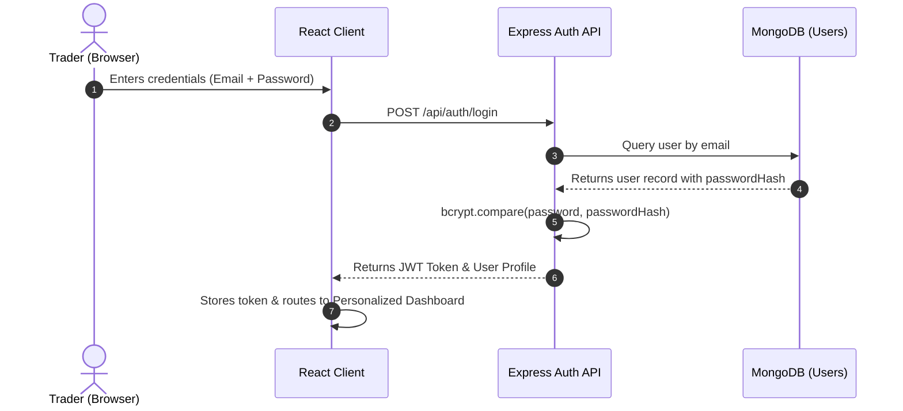
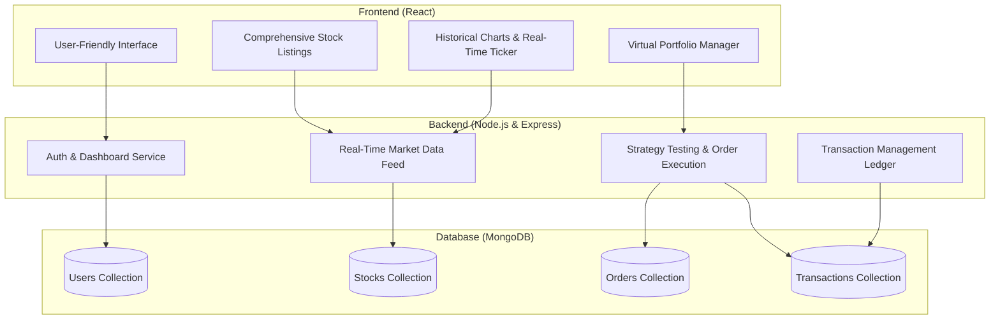

# TradeX — Platform Features Specification

Welcome to the comprehensive feature specification for **TradeX**, the simulation and portfolio management platform for US equities. This document provides an exhaustive breakdown of the platform's core functional capabilities, user journeys, data entity relationships, and architectural integrations.

---

## 📋 Feature Overview Matrix

| # | Feature | Core Capability | Target User | Associated Entities |
| :-: | :--- | :--- | :--- | :--- |
| **1** | [User Registration & Authentication](#1-user-registration--authentication) | Secure sign-up, JWT auth, and personalized dashboards | All Users & Admins | `Users` |
| **2** | [Real-Time Market Data](#2-real-time-market-data) | Live US stock prices, updates, and market trends for simulation | Traders & Observers | `Stocks`, External Stocks API |
| **3** | [Historical Data & Trends](#3-historical-data--trends) | Stock performance history for charting & backtesting | Strategy Planners | `Stocks`, Time-series data |
| **4** | [Virtual Portfolios](#4-virtual-portfolios) | Create and manage multiple portfolios, track P&L | Active Traders | `Users`, `Stocks`, `Portfolios` |
| **5** | [Transaction Management](#5-transaction-management) | Complete audit log of buy/sell activities linked to users & stocks | Compliance & Traders | `Transactions`, `Orders` |
| **6** | [Comprehensive Stock Listings](#6-comprehensive-stock-listings) | Browse through a wide selection of US market equities | Market Researchers | `Stocks`, Exchanges (NYSE, NASDAQ) |
| **7** | [Strategy Testing & Analysis](#7-strategy-testing--analysis) | Analyze past performance and refine trading strategies | Quantitative & Casual Traders | `Orders`, `Transactions`, `Stocks` |
| **8** | [User-Friendly Interface](#8-user-friendly-interface) | Intuitive UI/UX for both beginners and advanced traders | All Users | React Components, Charts |

---

## 1. 🔐 User Registration & Authentication

> **"Secure sign-up and login process with personalized dashboards."**

### 1.1 Description & Value Proposition
TradeX provides a secure onboarding gateway that establishes trader identity and protects user accounts. Upon authentication, users are welcomed into a custom, role-tailored dashboard showing immediate account balances, active holdings, and market summaries.

### 1.2 Key Capabilities
- **Streamlined Onboarding**: Instant registration with validation for email authenticity and credential security.
- **Robust Security**: Passwords salted and hashed with `bcryptjs`; stateless JWT (JSON Web Tokens) for authenticated API interactions.
- **Role-Based Access Control (RBAC)**: Distinct permissions separating standard simulated traders from system administrators.
- **Personalized Dashboard**: Real-time display of cash balance, total portfolio value, day gains/losses, watchlists, and quick-action shortcuts.

### 1.3 Technical & Data Flow

---

## 2. ⚡ Real-Time Market Data

> **"Live US stock prices, updates, and market trends for accurate trading simulations."**

### 2.1 Description & Value Proposition
Accurate trading simulations require realistic market feedback. TradeX connects to streaming market feeds to provide live updates for stocks listed across major US exchanges (NYSE, NASDAQ), ensuring simulated order execution reflects true market realities.

### 2.2 Key Capabilities
- **Live Stock Quotes**: Continuous real-time updates of Bid, Ask, Last Price, and Day High/Low.
- **Market Movers**: Automated tracking of top gainers, top losers, and highest-volume equities.
- **Order Price Accuracy**: Market orders execute against real-time ticker prices with realistic slippage modeling.
- **Exchange Coverage**: Live quotes across major US technology, financial, healthcare, and industrial sectors.

---

## 3. 📈 Historical Data & Trends

> **"Access stock performance history to analyze and test strategies effectively."**

### 3.1 Description & Value Proposition
In-depth technical analysis relies on reliable historical price action. TradeX maintains historical market feeds enabling traders to visualize trends over multiple timeframes and identify market support and resistance levels.

### 3.2 Key Capabilities
- **Multi-Period Historical Data**: Access historical OHLCV (Open, High, Low, Close, Volume) data across 1 Day (1D), 1 Week (1W), 1 Month (1M), 1 Year (1Y), and 5 Years (5Y).
- **Interactive Candlestick & Line Charts**: Toggle between candlestick price distributions and moving-average line charts.
- **Trend Spotting**: Visual indicators for price volatility, volume spikes, and moving averages.
- **Exportable Records**: Retrieve historical data series for custom analytical modeling.

---

## 4. 💼 Virtual Portfolios

> **"Create and manage multiple portfolios with diverse stocks. Track overall performance, profits, and losses."**

### 4.1 Description & Value Proposition
Virtual Portfolios allow users to simulate real-world investments without capital risk. Traders can organize assets across thematic portfolios (e.g., *Tech Growth*, *Dividend Income*, *Value Investing*) and benchmark performance.

### 4.2 Key Capabilities
- **Multi-Portfolio Creation**: Configure and maintain isolated virtual portfolios under a single user account.
- **Asset Diversification**: Hold fractional or whole shares across varied stock sectors.
- **Real-Time P&L Calculations**:
  - **Unrealized P&L**: `(Current Market Price - Average Purchase Price) * Share Count`
  - **Realized P&L**: Tracked immediately upon order settlement.
  - **Total ROI**: Percentage-based portfolio gain or loss tracked against initial simulated capital.
- **Asset Allocation Visualizations**: Pie and bar chart breakdowns of holdings by sector, industry, and market cap.

---

## 5. 📝 Transaction Management

> **"Log of all buy/sell activities linked to specific users and stocks."**

### 5.1 Description & Value Proposition
Transparency and accountability are vital in trading operations. TradeX records every single order, execution, fund deposit, and withdrawal in a tamper-resistant transaction ledger linked directly to user IDs and stock symbols.

### 5.2 Key Capabilities
- **Comprehensive Audit Trail**: Every trade execution produces a timestamped transaction record specifying price, volume, and total value.
- **User & Stock Linkage**: Query transaction history filtered by stock ticker symbol, date range, or transaction type (`BUY`, `SELL`, `DEPOSIT`, `WITHDRAWAL`).
- **Detailed Trade Receipts**: Full breakdown of trade fees, execution timestamps, order type (Market vs. Limit), and fulfillment state.
- **Compliance & Admin Oversight**: Administrators can view cross-platform transaction activity to monitor platform liquidity and trading patterns.

---

## 6. 🌐 Comprehensive Stock Listings

> **"Browse through a wide range of stocks listed in the US market."**

### 6.1 Description & Value Proposition
TradeX provides a rich directory of US-traded equities, giving users access to the breadth of the American financial ecosystem from mega-cap blue-chip corporations to emerging growth companies.

### 6.2 Key Capabilities
- **Extensive Catalog**: Browse equities across NYSE, NASDAQ, and AMEX.
- **Smart Search & Filters**: Search instantly by company name or ticker symbol (e.g., `AAPL`, `TSLA`, `MSFT`, `NVDA`).
- **Sector & Industry Categories**: Filter stocks by sectors such as Technology, Healthcare, Energy, Consumer Discretionary, and Financials.
- **Quick-Look Metrics**: High-level snapshot cards showing market cap, P/E ratio, 52-week high/low, and trading volume at a glance.

---

## 7. 🎯 Strategy Testing & Analysis

> **"Analyze past performance and refine trading strategies."**

### 7.1 Description & Value Proposition
Before risking real capital in live markets, traders can validate their trading hypotheses in TradeX. By combining historical data analysis with real-time paper trading, users refine risk management techniques, stop-loss rules, and profit targets.

### 7.2 Key Capabilities
- **Strategy Backtesting Evaluation**: Review how specific trade setups would have fared against historical price action.
- **Performance Analytics**: Win/loss ratio, average profit per winning trade vs. average loss per losing trade, and maximum portfolio drawdown.
- **Refinement Loop**: Adjust order parameters, test limit price orders, and observe simulated trade outcomes under differing market conditions.
- **Risk-Free Learning**: Explore aggressive vs. defensive allocation models with zero monetary exposure.

---

## 8. 🎨 User-Friendly Interface

> **"Intuitive design for both beginners and advanced traders."**

### 8.1 Description & Value Proposition
TradeX balances high-density financial data with clean, modern aesthetics. The interface is purposefully structured so that newcomers can execute trades within seconds, while advanced traders have immediate access to deep charting and portfolio analytics.

### 8.2 Key Capabilities
- **Adaptive Layout**: Responsive interface optimized across desktops, tablets, and mobile devices.
- **High-Contrast Dark & Modern Themes**: Sleek visual styling with glassmorphic cards, vibrant accent badges, and clean typography.
- **Accessible Order Slips**: One-click buy/sell modals with automated total-cost calculation and balance warnings.
- **Instant Feedback**: Toast notifications, progress indicators, and interactive micro-animations for trade execution and wallet operations.

---

## 🔗 Relationship to System Architecture

For complete architectural blueprints, tier specifications, and platform [Rules and Responsibilities](ARCHITECTURE.md#rules-and-responsibilities), see the [System Architecture Specification](ARCHITECTURE.md). For the backend design and routing layer, see the [SB Stocks MVC Pattern](MVC_PATTERN.md). For entity schemas and database design, see the [SB Stocks ER Diagrams](ER_DIAGRAMS.md). For the complete 9-stage trader workflow, see the [SB Stocks User Flow Specification](USER_FLOW.md). For setup and development instructions, see the main [README.md](../README.md).
