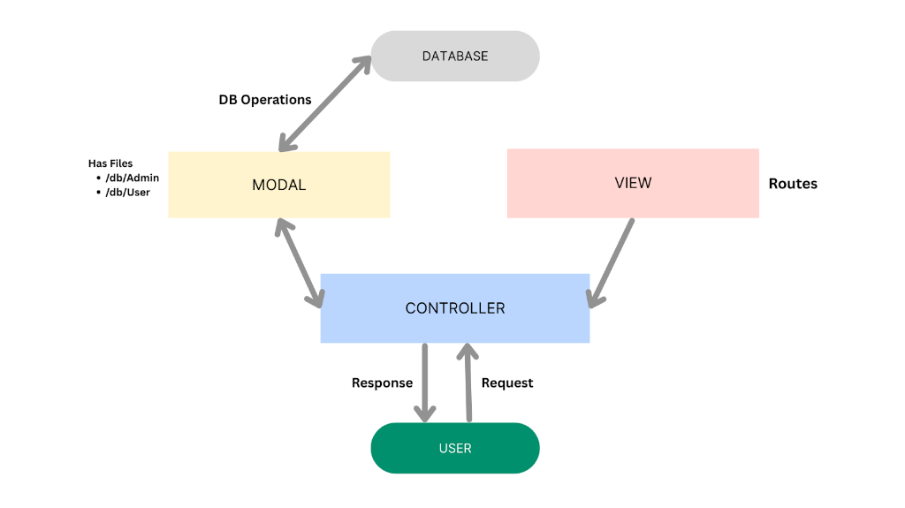
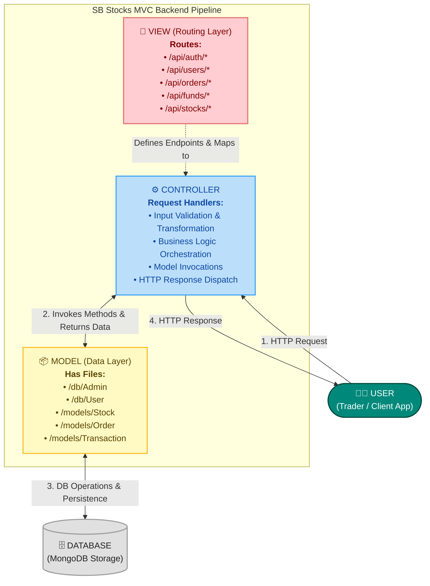
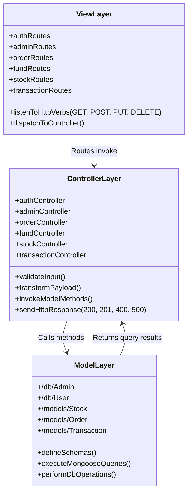
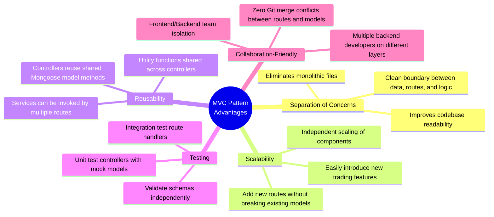
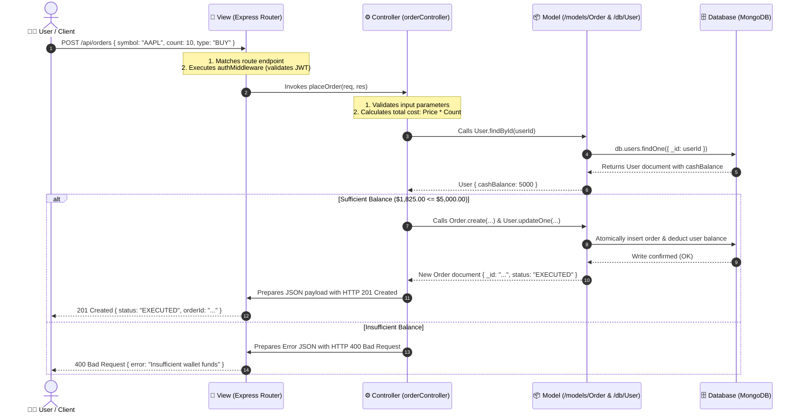

# TradeX — SB Stocks Model-View-Controller (MVC) Pattern Specification

[](https://expressjs.com/)
[](https://nodejs.org/)
[](https://mongoosejs.com/)
[](https://www.mongodb.com/)
[](#-architecture-overview)
[](ARCHITECTURE.md)

The **SB Stocks** application follows the **Model-View-Controller (MVC)** architectural pattern, a software design approach that separates an application into three interconnected layers. This separation allows for modularity, easier maintenance, and scalability.

In the context of the TradeX backend REST API, the MVC pattern decouples incoming HTTP requests and routing mechanisms from business decision-making and data storage operations, creating a clean pipeline for handling complex trading simulation events.

---

## 📐 Visual Architecture Diagram

The diagram below illustrates the structural relationships, data flow, and interface points between the User, View (Routing Layer), Controller, Model (Data Layer), and the underlying Database:



---

## 🔄 Interactive MVC Architecture Flowchart



---

## 🏗️ Detailed MVC Layer Responsibilities



---

### 1. 📦 Model Layer (Data Layer)

> **"The Model layer is responsible for handling all data-related logic. This includes the definition of data schemas and the operations performed on the database using those schemas. The models are implemented using Mongoose, which provides a schema-based solution to model application data for MongoDB."**

#### Core Responsibilities:
- **Data Schema Definition**: Strict typing, validations, default values, and relational keys (`ObjectId`) across all platform collections.
- **Database Operations**: Query execution (`find`, `findOne`, `create`, `updateOne`, `deleteOne`), aggregate calculations (P&L sums, liquidity totals), and index-optimized retrieval.
- **Data Integrity & Consistency**: Enforcing unique constraints (e.g. `email` uniqueness) and business constraints (e.g. non-negative stock counts).

#### Model Files & Structure:

| Model / Schema File | Purpose & Data Schema | Key Operations Executed |
| :--- | :--- | :--- |
| **`/db/User`** (`models/User.js`) | Defines trader accounts: username, email, hashed password, role (`User` \| `Admin`), and available cash balance. | • `User.findOne({ email })`<br/>• `User.create(userData)`<br/>• `User.findByIdAndUpdate(id, { cashBalance })` |
| **`/db/Admin`** (`models/Admin.js`) | Defines administrator permissions, system audit privileges, and elevated administrative credentials. | • `Admin.findOne({ username })`<br/>• `Admin.find()` platform governance |
| **`/models/Stock.js`** | User portfolio holdings: `Stock_Symbol`, `Stock_name`, `Price`, `Count`, `Total_price`, `Stock_Exchange`. | • `Stock.find({ UserId })`<br/>• `Stock.findOneAndUpdate({ UserId, Stock_Symbol })` |
| **`/models/Order.js`** | Trading order slips: `Stock_Symbol`, `Stock_name`, `Price`, `Count`, `Total_price`, `Stock_Type`, `Order_Type`, `Order_Status`. | • `Order.create(orderData)`<br/>• `Order.find({ UserId }).sort({ createdAt: -1 })`<br/>• `Order.findByIdAndUpdate(id, { Order_Status })` |
| **`/models/Transaction.js`** | Immutable financial audit ledger: `userId`, `Transaction_type`, `Payment_mode`, `Amount`, `Time`. | • `Transaction.create(txnData)`<br/>• `Transaction.find({ userId })` |

---

### 2. ⚙️ Controller Layer

> **"The Controller layer acts as an intermediary between the view (routes) and the model. It receives incoming requests, processes the input (which may include validation or transformation), calls the appropriate methods from the model, and then returns a response to the client."**

#### Core Responsibilities:
- **Request Ingestion**: Extracts route parameters (`req.params`), query strings (`req.query`), and JSON payloads (`req.body`).
- **Input Validation & Sanitization**: Verifies that required fields are present, values conform to data boundaries (e.g. order quantity > 0), and inputs are clean.
- **Business Logic Coordination**: Computes trade valuations (`Price * Count`), verifies user cash balances prior to order execution, and hashes passwords using `bcryptjs`.
- **Model Invocations**: Triggers CRUD operations through Mongoose models and handles asynchronous promises.
- **HTTP Response Dispatch**: Emits standardized JSON responses with proper HTTP status codes:
  - `200 OK` — Successful retrieval or state update.
  - `201 Created` — Successful resource creation (order placed, account registered).
  - `400 Bad Request` — Invalid input, insufficient wallet balance, or missing fields.
  - `401 Unauthorized` / `403 Forbidden` — Missing or invalid JWT tokens, insufficient privileges.
  - `404 Not Found` — Stock ticker or requested order not found.
  - `500 Internal Server Error` — Database connection drops or unhandled server exceptions.

#### Key Controller Modules:

```text
server/controllers/
├── authController.js         # User registration, credential verification, JWT issuance
├── adminController.js        # Admin dashboard analytics, platform user moderation
├── fundController.js         # Cash wallet deposits, withdrawals, and balance verification
├── orderController.js        # Market/Limit order processing, trade execution, order cancellation
├── stockController.js        # Stock market quote retrieval, ticker search, historical time-series
└── transactionController.js  # Transaction ledger lookup and audit record generation
```

---

### 3. 🧭 View Layer (Routing Layer)

> **"In the context of a backend REST API, the View is implemented as the routing layer, where various endpoints are defined. These endpoints determine how the backend responds to different HTTP requests (GET, POST, PUT, DELETE) and are responsible for invoking the appropriate controller functions."**

#### Core Responsibilities:
- **Endpoint Declaration**: Maps uniform resource identifiers (URIs) to specific system resources.
- **HTTP Method Matching**: Dispatches requests based on standard verbs (`GET`, `POST`, `PUT`, `DELETE`).
- **Middleware Attachment**: Hooks in security and validation middleware (e.g. `authMiddleware`, `adminMiddleware`, rate limiters) prior to reaching the controller.
- **Controller Binding**: Directly references and invokes controller handler methods upon matching.

#### Endpoint-to-Controller Mapping:

| HTTP Verb | Route Endpoint | Middleware | Controller Handler Invoked | Description |
| :---: | :--- | :--- | :--- | :--- |
| `POST` | `/api/auth/register` | `validateRegistration` | `authController.register` | Register new trader profile |
| `POST` | `/api/auth/login` | `validateLogin` | `authController.login` | Authenticate trader and issue JWT |
| `GET` | `/api/funds/balance` | `authMiddleware` | `fundController.getBalance` | Fetch available virtual cash |
| `POST` | `/api/funds/deposit` | `authMiddleware` | `fundController.deposit` | Add funds to trading wallet |
| `POST` | `/api/funds/withdraw` | `authMiddleware` | `fundController.withdraw` | Withdraw cash with overdraft check |
| `GET` | `/api/stocks` | Public | `stockController.getAllStocks` | Browse US stock listings |
| `GET` | `/api/stocks/:symbol` | Public | `stockController.getStockBySymbol` | Fetch live quote & chart data |
| `POST` | `/api/orders` | `authMiddleware` | `orderController.placeOrder` | Submit Market or Limit order |
| `GET` | `/api/orders` | `authMiddleware` | `orderController.getUserOrders` | View user order history |
| `PUT` | `/api/orders/:id/cancel`| `authMiddleware` | `orderController.cancelOrder` | Cancel pending order |
| `GET` | `/api/transactions` | `authMiddleware` | `transactionController.getHistory` | Fetch financial transaction ledger |
| `POST` | `/api/admin/auth/login` | Public | `adminController.adminLogin` | Administrator authentication |
| `GET` | `/api/admin/dashboard/stats`| `adminMiddleware` | `adminController.getDashboardStats` | Retrieve platform-wide metrics |

---

## 🌟 Advantages of Using MVC in This Project

The adoption of the MVC pattern in **SB Stocks (TradeX)** provides significant architectural and operational benefits:



### 1. 🎯 Separation of Concerns
Each layer has a clearly defined responsibility, improving readability and maintainability.
- The **Routing Layer** only handles URL matching and middleware pipeline routing.
- The **Controller Layer** encapsulates purely business and validation rules.
- The **Model Layer** only knows how to store, query, and enforce constraints on data schemas.

### 2. 📈 Scalability
New features can be added easily by creating new routes, controllers, and models.
- When introducing a new feature like **Watchlists** or **Price Alerts**, developers simply create `watchlistRoutes.js`, `watchlistController.js`, and `Watchlist.js` in the Model layer without altering core trade matching routines.

### 3. ♻️ Reusability
Logic in controllers and models can be reused across multiple parts of the application.
- Model methods like `User.findByIdAndUpdate` or balance verification helpers can be invoked interchangeably by both standard trading order controllers and administrative audit controllers.

### 4. 🧪 Testing
Each layer can be tested independently, especially the controllers and models.
- **Unit Testing**: Controllers can be tested in isolation using mock Mongoose models and synthetic `req`/`res` objects.
- **Model Validation Testing**: Schemas can be tested with Jest or Mocha to guarantee constraints (e.g. required fields, valid enum values) fail or pass as expected.
- **Route Testing**: Supertest can simulate HTTP requests against route definitions without touching production databases.

### 5. 👥 Collaboration-Friendly
Multiple developers can work simultaneously on different layers without conflict.
- One engineer can design and refine Mongoose schemas in `/db/` while another builds HTTP route definitions in `/routes/`, and a third implements the controller logic in `/controllers/` without causing code merge friction.

---

## 🔄 End-to-End Request-Response Flow in MVC

The sequence diagram below walks through a complete end-to-end user trade request as it traverses through every layer of the MVC pattern:



---

## 🔗 Related Documentation

- **[README.md](../README.md)**: Main project repository overview, quickstart instructions, and architecture summary.
- **[System Architecture Specification](ARCHITECTURE.md)**: 3-tier architecture specifications, component blueprints, and platform rules and responsibilities.
- **[SB Stocks ER Diagrams](ER_DIAGRAMS.md)**: Visual database schemas, entity relationship models, and data dictionary.
- **[SB Stocks User Flow](USER_FLOW.md)**: 9-stage end-to-end user journey, flowchart, and state transitions.
- **[Platform Features Specification](FEATURES.md)**: Comprehensive functional catalog and feature breakdown.
