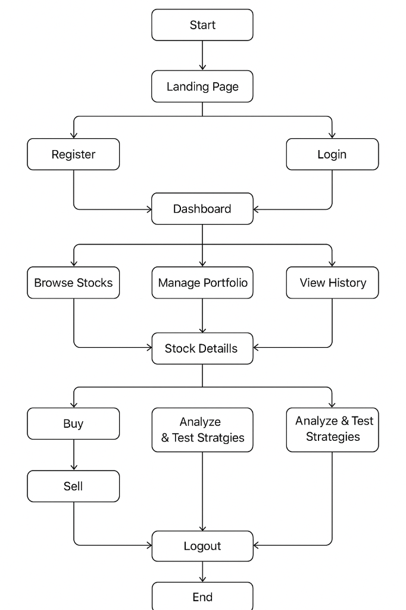
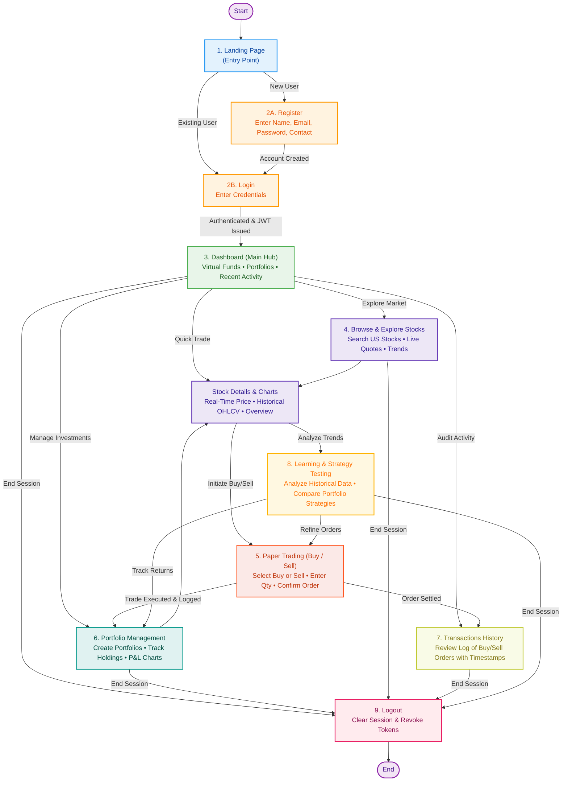

# TradeX — SB Stocks User Flow Specification

The **SB Stocks User Flow** maps out the comprehensive end-to-end journey of a user across the TradeX trading simulation platform. It illustrates how traders transition from first visiting the application and authenticating, through navigating the central dashboard, exploring US equities, executing simulated buy/sell orders, managing portfolios, auditing transactions, testing financial strategies, and securely ending their session.

---

## 📐 Visual User Flowchart

The diagram below illustrates the structural path and branching logic implemented across the application:

---

## 🔄 Interactive User Flow Diagram

The flowchart below represents the interactive lifecycle and multi-path routing across the SB Stocks web platform:

---

## 🚀 The 9-Stage User Journey Breakdown

### 1. 🌐 Entry Point
- **Context**: The user first discovers and navigates to the SB Stocks web application.
- **UI Route**: `/` (`LandingPage.jsx`)
- **Key Interactions**:
  - Displays platform value proposition, live market indices, top gainers/losers ticker, and trading features.
  - Presents clear calls-to-action: **"Get Started / Register"** for newcomers and **"Sign In / Login"** for returning traders.
- **System Responsibilities**:
  - Serves static responsive assets with high performance.
  - Queries public market ticker preview without requiring user authentication.

---

### 2. 🔐 Authentication
The platform provides distinct onboarding and sign-in channels to verify trader identity and protect user assets.

#### 2A. New User Registration Flow
1. **User Action**: Clicks **Register** on the landing page or navbar.
2. **Input Fields**:
   - `name`: Full trader name.
   - `email`: Valid contact and login email address.
   - `password`: Secure passphrase (minimum 8 characters with strength validation).
   - `contact`: Contact phone number for verification and security alerts.
3. **Client-Side Validation**: Checks password matching, email regex formatting, and required field completeness.
4. **Backend Processing**:
   - Endpoint: `POST /api/auth/register`
   - Verifies email uniqueness in MongoDB (`Users` collection).
   - Hashes password with `bcryptjs` (salt rounds: 12).
   - Initializes trader profile with a default virtual cash wallet balance (e.g., `$50,000.00 USD`).
5. **Outcome**: Displays success notification modal/toast and immediately **redirects user to Login**.

#### 2B. Existing User Login Flow
1. **User Action**: Clicks **Login** and inputs registered email and password credentials.
2. **Backend Processing**:
   - Endpoint: `POST /api/auth/login`
   - Compares credentials against database hash (`bcrypt.compare`).
   - Issues signed stateless **JSON Web Token (JWT)** containing `userId` and user permissions.
3. **Outcome**: Client stores JWT token (localStorage / secure cookie), sets global auth context, and **redirects to the Dashboard**.

---

### 3. 📊 Dashboard (Main Hub)
- **Context**: The command center and primary focal point for all authenticated trader interactions.
- **UI Route**: `/dashboard` (`UserHome.jsx`)
- **Key Displays**:
  - **Overall Virtual Funds**: Live cash wallet balance available for simulated trading.
  - **Portfolio Summary**: Aggregate market value across all user portfolios with daily unrealized P&L indicator.
  - **Recent Activity Feed**: Real-time snapshot of the 5 most recent orders and transactions.
  - **Market Snapshot**: Quick widget tracking major US stock movements.
- **Core Hub Navigation Options**:
  - **Browse Stocks**: Explore the complete US market catalog.
  - **Create Portfolio**: Set up a new isolated virtual portfolio.
  - **View Portfolio**: Inspect existing portfolio holdings, distribution, and performance.
  - **Trade Stocks**: Launch the quick order slip to execute paper trades.

---

### 4. 🔍 Browse & Explore Stocks
- **Context**: Market research and stock discovery interface.
- **UI Route**: `/stocks` (`BrowseStocks.jsx`)
- **Key Interactions**:
  - **Instant Search**: Search US-listed stocks by ticker symbol (e.g., `AAPL`, `MSFT`, `TSLA`, `GOOGL`, `NVDA`) or corporate name.
  - **Sector Filtering**: Filter equities by sector (Technology, Healthcare, Energy, Finance, Consumer Goods).
  - **Real-Time Price & Trends**: Live Bid/Ask quotes, daily price change dollar amounts, percentage changes, and 24-hour volume.
  - **Stock Inspection**: Clicking any stock card navigates to the detailed view with historical candlestick/line charts, 52-week ranges, market cap, and company profiles.

---

### 5. 📈 Paper Trading (Buy/Sell)
- **Context**: Realistic, risk-free simulated trade execution without financial capital exposure.
- **UI Route**: `/trade/:symbol` or Trade Modal (`StockOrders.jsx`)
- **Trading Workflow**:
  1. **Select Stock**: Chooses target equity ticker (e.g., `AAPL`).
  2. **Choose Direction**: Toggles between **BUY** and **SELL** order modes.
  3. **Order Parameters**: Selects order category (**MARKET** or **LIMIT**) and enters desired share quantity.
  4. **Cost Estimation**: Dynamic calculator computes `Total Cost = Quantity × Current Price` + estimated simulated fees.
  5. **Validation Check**:
     - *For Buy*: Verifies that available cash balance is sufficient (`cashBalance >= totalCost`).
     - *For Sell*: Verifies that the user owns sufficient shares in the selected portfolio (`sharesOwned >= quantity`).
  6. **Confirm Transaction**: Trader clicks **Confirm Order**.
- **System Execution & Real-Time Sync**:
  - Endpoint: `POST /api/orders`
  - Atomic database update: Deducts/credits cash balance in `Users`, creates an entry in `Orders`, updates portfolio holdings in `Stocks`, and appends a record in `Transactions`.
  - Emits real-time state update to client UI; portfolio valuation and transaction lists refresh instantly without page reload.

---

### 6. 💼 Portfolio Management
- **Context**: Multi-portfolio management, asset allocation, and performance tracking.
- **UI Route**: `/portfolios` (`PortfolioPage.jsx`)
- **Key Capabilities**:
  - **Create Multiple Virtual Portfolios**: Set up separate portfolios dedicated to distinct strategies (e.g., *"Tech Growth"*, *"Dividend Income"*, *"Short-Term Momentum"*).
  - **Add/Remove Stocks**: Allocate purchased shares to specific portfolios or rebalance positions.
  - **Holdings Table**: Displays ticker, company name, shares count, average acquisition price, live market price, current total value, and unrealized profit/loss.
  - **Performance Charts**:
    - **Asset Allocation**: Interactive pie chart displaying sector and stock weighting.
    - **P&L Visualizer**: Bar charts showing gain/loss trajectories across daily, weekly, and monthly intervals.

---

### 7. 📜 Transactions History
- **Context**: Complete, immutable financial and order settlement audit log.
- **UI Route**: `/transactions` (`TransactionsPage.jsx`)
- **Ledger Information**:
  - Unique Transaction Reference ID.
  - Exact timestamp of execution.
  - Transaction Type (`STOCK_BUY`, `STOCK_SELL`, `DEPOSIT`, `WITHDRAWAL`).
  - Stock Symbol and Company Name.
  - Executed Price, Share Count, and Net Monetary Total.
  - Payment Mode (`WALLET`).
  - Settlement Status (`SUCCESS`, `PENDING`, `FAILED`).
- **Filtering & Search**: Search transactions by date range, specific stock symbol, or order direction.

---

### 8. 🧠 Learning & Strategy Testing
- **Context**: Strategy experimentation, quantitative evaluation, and skill refinement.
- **UI Route**: `/analytics` (`StrategyTesting.jsx`)
- **Capabilities**:
  - **Historical Trend Analysis**: Review multi-period OHLCV charts (1D, 1W, 1M, 1Y, 5Y) to spot recurring technical patterns (support/resistance, moving average crossovers).
  - **Strategy Comparison**: Compare returns between different virtual portfolios (e.g., comparing a high-beta growth portfolio against a low-beta dividend portfolio).
  - **Execution Review**: Analyze win/loss rates, average gain per winning trade vs. average loss per losing trade, and maximum portfolio drawdown.
  - **Iteration**: Refine limit prices, trade sizing, and exit disciplines based on empirical simulation results.

---

### 9. 🚪 Logout
- **Context**: Secure termination of user session.
- **Workflow**:
  1. Trader clicks **Logout** from user dropdown menu or navigation bar.
  2. Client clears stored JWT authentication token from browser storage.
  3. Resets in-memory React application state (user profile, cash wallet balance, active portfolio cache).
  4. Securely redirects trader back to the public **Landing Page** (`/`).

---

## 🗺️ State Transition Matrix

The table below outlines how user actions trigger state transitions across the frontend views, backend APIs, and persistence collections:

| Current State | User Action / Trigger | Next State | Frontend View | Backend API Endpoint | Database Collection Impact |
| :--- | :--- | :--- | :--- | :--- | :--- |
| **Unauthenticated** | Enters website URL | Landing Page View | `LandingPage.jsx` | Static Asset Serve | None |
| **Landing Page** | Clicks "Register" | Register Screen | `RegisterModal.jsx` | None | None |
| **Register Screen** | Submits credentials | Login Screen (Redirect) | `LoginModal.jsx` | `POST /api/auth/register` | `Users` (Insert user record) |
| **Login Screen** | Submits login credentials | Authenticated Dashboard | `UserHome.jsx` | `POST /api/auth/login` | `Users` (Fetch & verify credentials) |
| **Dashboard** | Clicks "Browse Stocks" | Stock Catalog View | `BrowseStocks.jsx` | `GET /api/stocks` | `Stocks` (Read market catalog) |
| **Browse Stocks** | Selects specific stock | Stock Detail & Chart | `StockDetail.jsx` | `GET /api/stocks/:symbol` | `Stocks` (Read quote & history) |
| **Stock Detail** | Clicks "Buy Stock" | Buy Order Confirmation | `OrderSlip.jsx` | `POST /api/orders` | `Orders`, `Users`, `Stocks`, `Transactions` |
| **Stock Detail** | Clicks "Sell Stock" | Sell Order Confirmation | `OrderSlip.jsx` | `POST /api/orders` | `Orders`, `Users`, `Stocks`, `Transactions` |
| **Dashboard** | Clicks "Manage Portfolio"| Portfolio Overview | `PortfolioPage.jsx` | `GET /api/portfolios` | `Stocks` (Read user holdings) |
| **Portfolio View** | Creates new portfolio | Updated Portfolio List | `PortfolioModal.jsx` | `POST /api/portfolios` | `Portfolios` (Create portfolio) |
| **Dashboard** | Clicks "View History" | Transactions Log View | `TransactionsPage.jsx`| `GET /api/transactions` | `Transactions` (Query ledger) |
| **Stock Detail** | Clicks "Analyze Strategies" | Strategy Analytics View | `StrategyTesting.jsx`| `GET /api/stocks/:symbol/history` | `Stocks` (Historical data read) |
| **Any Authenticated**| Clicks "Logout" | Public Landing Page | `LandingPage.jsx` | Client Token Purge | None |

---

## 🛡️ Error & Edge Case Handling in User Flow

1. **Duplicate Email During Registration**:
   - Backend returns `409 Conflict`.
   - UI displays clear notification: *"An account with this email already exists. Please login instead."*
2. **Invalid Login Credentials**:
   - Backend returns `401 Unauthorized`.
   - UI flags invalid fields without exposing whether email or password was the incorrect element.
3. **Insufficient Funds on Buy Order**:
   - Trade modal disables submit button with warning: *"Insufficient virtual cash balance. Requires $X, available $Y."*
4. **Overselling Shares on Sell Order**:
   - Order validation rejects requests when `orderQuantity > ownedShares`.
   - UI warns: *"Cannot sell more shares than currently held in portfolio."*
5. **Token Expiration / Invalid Session**:
   - Express `authMiddleware` returns `401 Unauthorized`.
   - Client interceptor clears stale token, presents a session expiration notice, and redirects user to `/login`.

---

## 🔗 Related Documentation

- **[README.md](../README.md)**: Main project overview, quickstart instructions, and system tier summary.
- **[SB Stocks MVC Pattern](MVC_PATTERN.md)**: Model-View-Controller design architecture, routing/controller mappings, and schema operations.
- **[Platform Features Specification](FEATURES.md)**: Exhaustive breakdown of features, trader capabilities, and UX matrices.
- **[System Architecture Specification](ARCHITECTURE.md)**: Detailed tier-by-tier architecture, component communication, and system responsibility rules.
- **[SB Stocks ER Diagrams](ER_DIAGRAMS.md)**: Relational schema, collection attribute dictionaries, and data models.
